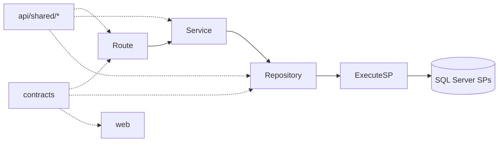
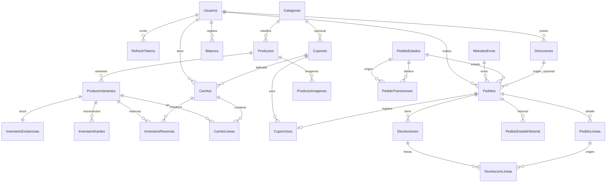

# ShopCart — Arquitectura v4.2

**Reto:** Tech Challenge 360 · Grupo Pentandra · Full Stack Middle/Senior  
**Versión:** 4.2 · 30 oct 2026 (America/Guatemala, UTC-6) — v4.1 sincronizada con la implementación de la Fase 1 (ver §0, «v4.1 → v4.2»).  
**Alcance:** diseño de referencia. La Fase 1 (BD y API) está implementada y probada; el frontend (Fase 2) sigue pendiente. Si algo difiere entre este documento y el código, **manda el código** y la diferencia está listada abajo.  
**Fuente de verdad:** *Tech Challenge 360 - Reto ShopCart - Enunciado.pdf* (15 págs.). Las citas `«…»` son textuales del enunciado.

---

## 0. Cambios

### v4.1 → v4.2 (desviaciones de la implementación)

| # | Diseño v4.1 | Implementación | Motivo |
|---|-------------|----------------|--------|
| I1 | SPs reciben `@IDUsuarioSesion` **y** `@RolSesion` desde el JWT | Reciben solo `@IDUsuarioSesion`; el rol se consulta en la BD con `SP_Auth_ExigirRol(@IDUsuarioSesion, @Roles)` | El rol del JWT puede estar desactualizado hasta 15 min; la BD es la autoridad y un SP llamado directo tampoco acepta un rol inventado |
| I2 | `SP_Bitacora_Registrar` en `008` | Está en `004` (los SPs de auth/catálogo la usan antes) | Orden de dependencias entre scripts |
| I3 | `FechaLocal = … AT TIME ZONE 'Central America Standard Time'` | `DATEADD(HOUR, -6, FechaCreacion)` (Guatemala no usa horario de verano); los filtros convierten con `DATEADD(HOUR, 6, …)` | Independiente de la configuración de zonas horarias del servidor y del contenedor; más simple y verificable |
| I4 | `GET /checkout` sin checkout iniciado → 404 | **409 `CHECKOUT_NO_INICIADO`** (50011); sin carrito → 400 `CARRITO_VACIO` | Es un estado de la compra, no un recurso inexistente; el FE decide iniciar el checkout |
| I5 | Errores de stock con `details` (variante, disponible) | Sin `details`; el mensaje es claro y estable | Los SPs lanzan `THROW` con mensaje; no se simula un cuerpo estructurado |
| I6 | Internos `SP_Inventario_AplicarMovimiento`, `ExpirarReservas`, `ReintegrarExistencia` sin detallar | Requieren `@@TRANCOUNT > 0` (`THROW 50098` si no) y no abren transacción propia | Garantiza que el kardex y la reserva se confirman o revierten junto con quien los llama |
| I7 | Seed: 8 categorías, 1 admin + 2 operadores + 30 clientes (1 desactivado) | 6 categorías, 40 productos (2 descontinuados), 119 variantes, 1 admin + 2 operadores + 32 clientes (1 desactivado), 8 cupones, 420 pedidos, 15 carritos abandonados | Volumen suficiente para dashboard y rendimiento; ver `011_seed_volumen.sql` |
| I8 | Seed completo en `010_seed.sql` | `010` = datos fijos + usuarios de prueba; `011_seed_volumen.sql` = catálogo, stock, clientes, cupones y pedidos históricos generados con los SPs reales | Separa lo imprescindible de lo demostrativo |
| I9 | El seed retrofechaba también la bitácora | **No se toca la bitácora** (sus entradas llevan la fecha real de carga) | La inmutabilidad vale también para el seed: no se deshabilitan triggers |
| I10 | Desglose de IVA solo en §5 | Implementado: `iva` en carrito, opciones de envío y pedido (`Total − ROUND(Total/1.12, 2)`) | Contexto del enunciado: precios con IVA incluido |
| I11 | `SP_Reportes_*` (5) + `SP_Bitacora_Listar` | Se agrega el auxiliar `SP_Reportes_ResolverRango` (valida fechas, rango por defecto de 30 días, máximo 2 años) | Una sola regla de rango para los 4 reportes |
| I12 | Contratos de cart/coupons/orders/reports «por definir» | Implementados en `contracts/src/{cart,coupons,orders,reports}.ts`; `TRANSICIONES` vive en `orders.ts` | Fuente única para API y web |
| I13 | OpenAPI «generado» (sin herramienta fijada) | `api/src/openapi.ts` (z.toJSONSchema) + `swagger-ui-express`; una prueba compara las rutas de Express con las documentadas | Cero deriva entre código y documentación |
| I14 | Carrito: columnas por definir | Cada línea expone `disponible` y `problema` (`INACTIVA`, `SIN_STOCK`, `EXCEDE_DISPONIBLE`); el carrito expone `reservaExpiraEn` | El FE puede mostrar el estado sin llamadas adicionales |
| I15 | Pruebas T-05…T-14 en el plan | Implementadas como 110 pruebas de integración (ver README §7); T-11 incluye la venta de las 23:00 locales | Evidencia ejecutable de los criterios de aceptación |

### v4 → v4.1 (contraste con el enunciado)

| # | Texto del enunciado | Problema en v4 | Corrección v4.1 |
|---|---------------------|----------------|-----------------|
| E1 | Estándar BD: `FU_` = «Función tipo tabla»; ejemplos `SP_Inventario_ReservarExistencia`, `VW_Dashboard_VentasPorCategoria`, `VW_Pedidos_Historial`, `FU_Catalogo_PrecioVigente` | Había funciones escalares con prefijo `FU_` y se habían eliminado/renombrado los objetos de ejemplo | Todas las `FU_` son **inline TVF**; los 4 objetos de ejemplo existen con un propósito real (§7.1) |
| E2 | RF-07: «Una transición no permitida se rechaza **en el backend y en la base de datos**» | Solo la BD validaba | Grafo como constante en `contracts`; `orders.service` valida antes del SP; la BD valida con `PedidoTransiciones`; T-06 prueba ambas capas |
| E3 | Contexto: «Respetar el precio y el descuento que el cliente vio al confirmar la compra, aunque cambien después» | Un cambio de precio durante el checkout producía `409 TOTAL_CAMBIO` | El precio se **congela al iniciar el checkout** (en la reserva) y se respeta durante los 15 min; `FU_Catalogo_PrecioVigente` es la única regla de qué precio aplica |
| E4 | Glosario: Checkout = «confirmar dirección, envío, **cupón** y pago» | Aplicar cupón liberaba la reserva; recargar la página perdía el checkout | Cupón no libera reservas; nuevo `GET /checkout` (`SP_Pedidos_ObtenerCheckout`) reconstruye el estado |
| E5 | RF-09: «Toda creación, modificación o desactivación en […] **existencias** […] queda registrada» | Las ventas no escribían bitácora por movimiento | Todo movimiento de kardex (incluida la venta) escribe bitácora |
| E6 | RF-05: «Cada cupón **tiene** […] límite total de usos y límite de usos por cliente» | Límites opcionales (NULL) | Ambos `NOT NULL`, `> 0` |
| E7 | RF-07: «Un pedido puede cancelarse mientras no haya sido despachado» | El cliente solo podía cancelar en `Pagado` | Cliente y Operador cancelan en `Pagado` o `Preparando` |
| E8 | Evaluación (20 pts): «…transacciones, **migraciones**…» | Scripts sin control de versión aplicado | Tabla `VersionesEsquema` + runner que aplica solo scripts pendientes (§3.2) |
| E9 | RNF: «responden en menos de 1 segundo con los datos semilla»; penalización: «Problemas de rendimiento» | Seed sin volumen definido; dashboard vacío en la demo | Seed con volumen y meses de historial (§3.4) + prueba de rendimiento T-13 |
| E10 | Técnico: «Todo el acceso a datos (creación, edición y **lectura**) se hace mediante stored procedures» | v4 daba `SELECT` sobre vistas al login de la app | El login de la app solo tiene `EXECUTE`; vistas y funciones solo se usan dentro de SPs |
| E11 | RF-04: «El total del carrito no presenta errores de redondeo» | Sin prueba explícita | T-14 |
| E12 | §06: «El enunciado deja abiertas algunas decisiones a propósito… La claridad de esas decisiones forma parte de la evaluación» | Decisiones mezcladas con supuestos por verificar | §12 separa las **decisiones abiertas del enunciado** con su postura y justificación (van tal cual al README) |

Resueltos por el enunciado (ya no son supuestos): el ciclo de vida lo define el participante (RF-07) → se mantiene sin `PendientePago`; el Operador gestiona pedidos e inventario y el Administrador «además catálogo, precios, cupones, usuarios y reportes» (RF-01) → coincide con v4; quién registra devoluciones no está especificado → decisión abierta documentada.

### v3 → v4

| # | Punto de quiebre en v3 | Consecuencia si no se corrige | Corrección v4 |
|---|------------------------|-------------------------------|---------------|
| 1 | No existía catálogo de endpoints ni formas de respuesta | El FE (Fase 2) descubre faltantes cuando la API ya está "cerrada" | §9 contrato API completo + §10 matriz pantalla → endpoint |
| 2 | Tipos zod "reusables en FE" pero sin paquete compartido | API y FE divergen en nombres/tipos | Workspace `contracts/` (zod + tipos + códigos de error + enums) usado por `api` y `web` |
| 3 | Transporte de tokens no definido (cookie vs body, CORS) | Refresh roto entre `:5173` y `:3000`; sesión se pierde al recargar | Refresh en cookie httpOnly + proxy Vite (mismo origen); access en memoria (§5.6) |
| 4 | Carrito invitado sin mecanismo de transporte | FE no sabe cómo identificar el carrito invitado | Header `X-Cart-Token`, generado por la API, fusión al login (§5.7) |
| 5 | `PendientePago` en el grafo, pero el pedido nace pagado en `SP_Pedidos_CrearPedido` | Estado muerto; reportes ambiguos | Pedido nace en `Pagado`; `PendientePago` eliminado (RF-07 deja el ciclo de vida al participante) |
| 6 | Grafo sin `DevueltoParcial → DevueltoParcial/DevueltoTotal`; devolución permitida desde `Pagado` | Segunda devolución parcial imposible; solapamiento con cancelación | Devolución solo desde `Entregado`/`DevueltoParcial`; transiciones tipificadas por mecanismo (§8.2) |
| 7 | Descuento de cupón no prorrateado por línea | Reembolso de devolución parcial incalculable; reportes netos incorrectos | `DescuentoLinea` prorrateado + `MontoReembolso` por línea devuelta (§8.4) |
| 8 | API conectando como `sa` (implícito en `.env`) | `DENY` no aplica a sysadmin → "bitácora inmutable" indefendible | Login de app `shopcart_app` solo con `EXECUTE`; triggers `INSTEAD OF` como garantía real (§7.3) |
| 9 | `UNIQUE(LlaveIdempotencia)` global y sin manejo de carrera | Dos requests simultáneos con la misma llave → error 500 | `UNIQUE(IDUsuario, LlaveIdempotencia)` + lectura con `UPDLOCK, HOLDLOCK` (§8.1) |
| 10 | Refresh "revoca familia" sin columna de familia | Detección de reuso no implementable | `RefreshTokens.Familia UNIQUEIDENTIFIER` |
| 11 | Reportes agrupando por fecha UTC | Ventas de 18:00–23:59 GT caen en el día siguiente | Agrupación en `America/Guatemala` vía columna `FechaLocal` de `VW_Dashboard_LineasNetas` (§5.4) |
| 12 | Reglas RF-08 repetidas en varias vistas/SPs; `SP_Reportes_ListarPedidos` duplicaba `SP_Pedidos_ListarAdmin` | Números distintos entre KPI y gráficas | Una sola vista base `VW_Dashboard_LineasNetas`; listado único `SP_Pedidos_ListarAdmin` |
| 13 | Faltaban SPs que el FE necesita: detalle de producto, listado de existencias, crear operador, cambiar rol | Pantallas sin endpoint | Agregados (§7.1) |
| 14 | Cambios al carrito durante checkout no definidos | Reservas no coinciden con líneas → sobreventa o bloqueo | Toda mutación del carrito libera reservas activas; `CrearPedido` exige coincidencia exacta |
| 15 | Precio podía cambiar entre "Iniciar checkout" y "Pagar" sin aviso | Cliente paga monto distinto al mostrado | Precio congelado en la reserva (ver E3) + `totalEsperado` como salvaguarda (`409 TOTAL_CAMBIO`) |
| 16 | Costo de envío y total por método no calculados por la API | FE calcularía dinero (riesgo de diferencias) | `IniciarCheckout` devuelve `opcionesEnvio` con total por método; **el FE nunca calcula montos** |
| 17 | Kardex con "signo por tipo" implícito | Invariante difícil de probar; ajustes ± ambiguos | `Cantidad` con signo; invariante `SUM(Cantidad) = CantidadFisica` |
| 18 | Variante nueva sin fila de existencias; seed con stock directo | Reserva falla (`NULL`); kardex no cuadra con seed | `SP_Catalogo_CrearVariante` crea existencia 0; seed carga stock solo con `SP_Inventario_Entrada` |
| 19 | `db/run.mjs` sin dependencias propias ni manejo de `GO`/arranque de SQL Server | "Máquina limpia" falla en el primer comando | npm workspaces + runner con split de `GO`, reintentos y `healthcheck` en compose (§3.2) |
| 20 | Sin convención de nombres de constraints | Errores de duplicado (correo, SKU) llegan como 500 | `UQ_/FK_/CK_/IX_` + mapeo constraint → código de error (§5.9) |
| 21 | Deadlocks posibles al reservar varias variantes | 500 intermitentes en checkout concurrente | Bloqueo en orden `IDVariante ASC` + reintento automático de `1205` |
| 22 | SPs anidados con `BEGIN TRAN` propios | Rollbacks parciales / `@@TRANCOUNT` mismatch | SPs internos no abren transacción; plantilla SP única (§7.2) |
| 23 | `FU_Catalogo_PrecioVigente`, `VW_Pedidos_Historial` sin uso real; `SP_Pedidos_ObtenerHistorialEstados` duplicado | Objetos que no se pueden justificar en la defensa | Los dos primeros se conservan con propósito real (ver E1); el SP duplicado se elimina (el historial va en el detalle del pedido) |
| 24 | Decisión B (Roles) pendiente bloqueaba `002_tables.sql` | Arranque bloqueado | Adoptada la recomendación: columna `Rol` + CHECK |

---

## 1. Visión y stack

Tienda en línea: catálogo con variantes, inventario con kardex y reservas, carrito (cliente e invitado), cupones, checkout idempotente, pedidos con devoluciones parciales, dashboard y bitácora inmutable.

**Principio:** pocos archivos, vertical slices, dependencias en un solo sentido, toda la BD vía stored procedures. Nada de ORM, nada de SQL en TypeScript, nada de capas vacías. **Un único contrato (`contracts/`) compartido por API y web.** Cada archivo debe poder explicarse en la defensa.

### Stack

| Capa | Tecnología | Por qué |
|------|------------|---------|
| BD | SQL Server 2022 Express (Docker; compatible 2019+) | Exigido. Sin SQL Agent → job Node libera reservas. |
| Scripts | 10 `.sql` numerados + `db/run.mjs` | Reproducibles; sin ORM. |
| Monorepo | npm workspaces (`contracts`, `api`, `web`, `db`) | Nativo de npm; sin Nx/Turborepo. |
| Contrato | `contracts/` con `zod` | Una sola definición de requests, respuestas, enums y códigos de error. |
| API | Node 24 LTS + Express + TypeScript `strict`, ejecutado con `tsx` | Exigido. `tsx` permite importar `contracts` como TS fuente sin build intermedio; `tsc --noEmit` para typecheck. |
| Driver | `mssql` (tedious) | Parámetros tipados, pool, múltiples recordsets. |
| Auth | `jsonwebtoken` + `argon2` + `cookie-parser` | JWT + hash argon2id (RF-01); refresh en cookie httpOnly. |
| HTTP seguro | `helmet`, `cors`, `express-rate-limit` | Cabeceras + CORS (RNF). Rate limit en auth. |
| Logs | `pino` + `pino-http` | JSON, `requestId` por request. |
| Docs API | `@asteasolutions/zod-to-openapi` + `swagger-ui-express` | OpenAPI **generado** desde `contracts` → no se desincroniza. |
| Jobs | `node-cron` | `SP_Inventario_LiberarReservasVencidas` cada 60 s. |
| Tests | `vitest` + `supertest` contra BD real en Docker | Concurrencia, ownership, invariantes. |
| Web | React 18 + TypeScript + Vite | Exigido. |
| Rutas UI | React Router v6 | Protección por rol. |
| Datos UI | TanStack Query | Caché, invalidación, refresh transparente. |
| Forms | React Hook Form + `@hookform/resolvers/zod` | Mismos esquemas que valida la API. |
| UI | Mantine v7 | Tablas, paginación, notificaciones. |
| Gráficas | Recharts | Dashboard (RF-08). |
| Dev | `concurrently` (raíz) | `npm run dev` levanta API + web. |
| Estilo | ESLint + Prettier (config compartida en raíz) | Evaluación: «apego al estándar de código» en backend y frontend. |

**Fuera de alcance a propósito:** Prisma/TypeORM/Knex, NestJS, Redux, Nx/Turborepo, DI frameworks, cambio de contraseña/recuperación por correo.  
**Extras solo si sobra tiempo:** WebSockets/SSE, export Excel/PDF, caché de reportes (máx. +10 pts; no compensan un RF faltante).

---

## 2. Cobertura RF → tablas / SPs / endpoints / pantallas

Cada RF mapea a objetos concretos. Si no aparece aquí, no se construye.

| RF | Qué exige el enunciado | Tablas | SPs / vistas clave | Endpoints (§9) | Pantallas (§10) |
|----|------------------------|--------|--------------------|----------------|-----------------|
| **RF-01** Auth y acceso | 3 roles; registro; JWT + refresh con rotación; ownership; soft-deactivate | `Usuarios` (col. `Rol`), `RefreshTokens`, `Direcciones` | `SP_Auth_*`, `SP_Direcciones_*` | `/auth/*`, `/me/direcciones`, `/admin/usuarios` | Login, registro, mis direcciones, admin usuarios |
| **RF-02** Catálogo | CRUD categorías/productos/variantes; SKU; búsqueda/filtros; soft-delete | `Categorias`, `Productos`, `ProductoVariantes`, `ProductoImagenes` | `SP_Catalogo_*`, `VW_Catalogo_ProductosTienda`, `FU_Catalogo_PrecioVigente` | `/catalog/*` | Catálogo, detalle producto, admin catálogo |
| **RF-03** Inventario | Kardex; disponible = físico − reservado; ajuste con motivo | `InventarioExistencias`, `InventarioKardex`, `InventarioReservas` | `SP_Inventario_*`, `VW_Inventario_Disponible` | `/inventory/*` | Operador inventario, kardex |
| **RF-04** Carrito | CRUD líneas; subtotal/descuento/total; no superar disponible | `Carritos`, `CarritoLineas` | `SP_Carrito_*`, `FU_Carrito_CalcularTotales` | `/cart/*` | Carrito, badge en header |
| **RF-05** Cupones | %/fijo; vigencia; mínimos; límites total y por cliente; 1 por pedido; categoría opcional | `Cupones`, `CuponUsos` | `SP_Cupones_*`, `FU_Cupones_CalculoDescuento` | `/coupons/*`, `/cart/cupon` | Admin cupones; aplicar en carrito |
| **RF-06** Checkout | Dirección; reserva 15 min; sin sobreventa; idempotencia; atomicidad | `Direcciones`, `MetodosEnvio`, `Pedidos`, `PedidoLineas`, `InventarioReservas` | `SP_Pedidos_IniciarCheckout`, `SP_Pedidos_ObtenerCheckout`, `SP_Pedidos_CrearPedido`, `SP_Pedidos_CancelarCheckout`, `SP_Inventario_ReservarExistencia` | `/checkout/*`, `POST /orders` | Checkout (dirección → envío → confirmar) |
| **RF-07** Pedidos / devoluciones | Ciclo de vida documentado; cancelar pre-despacho; devolución parcial; historial | `PedidoEstados`, `PedidoTransiciones`, `Pedidos`, `PedidoLineas`, `PedidoEstadoHistorial`, `Devoluciones`, `DevolucionLineas` | `SP_Pedidos_CambiarEstado`, `SP_Pedidos_Cancelar`, `SP_Pedidos_CrearDevolucion`, `SP_Pedidos_ObtenerPorId`, `VW_Pedidos_Historial` | `/orders/*` | Mis pedidos, detalle; operador pedidos |
| **RF-08** Dashboard | Ventas día/semana/mes; por categoría; top 10; listado filtrado; solo completados − devoluciones | (lectura) | `VW_Dashboard_LineasNetas`, `VW_Dashboard_VentasPorCategoria`, `SP_Reportes_*`, `SP_Pedidos_ListarAdmin` | `/reports/*`, `GET /orders` | Dashboard admin |
| **RF-09** Bitácora | Alta/cambio/baja en productos, precios, existencias, cupones, estados; inmutable | `Bitacora` | `SP_Bitacora_Registrar` (interno), `SP_Bitacora_Listar`; triggers | `/audit` | Admin bitácora |

### Criterios de aceptación críticos

| Criterio | Mecanismo | Test (§11) |
|----------|-----------|------------|
| Ownership (RF-01) | `@IDUsuarioSesion` desde el JWT; el rol se consulta en la BD (`SP_Auth_ExigirRol`); `THROW 50043` → 403 | T-07 |
| Precio no altera pedidos hechos (RF-02) | Congelado en `PedidoLineas` | T-08 |
| Se respeta el precio que el cliente vio (Contexto) | Precio congelado en `InventarioReservas` al iniciar checkout | T-08 |
| Total del carrito sin errores de redondeo (RF-04) | `DECIMAL(18,2)` + `ROUND` en BD; FE no calcula | T-14 |
| Existencia = suma kardex (RF-03) | Kardex con signo; solo movimientos físicos | T-05 |
| Ajuste no deja negativo (RF-03) | `THROW 50060` si físico resultante < 0 o < reservado | T-05 |
| Carrito ≤ disponible (RF-04) | Validación en `SP_Carrito_AgregarLinea` / `ActualizarCantidad` | T-09 |
| Cupón concurrente (RF-05) | `UPDLOCK` sobre fila de cupón + update condicional | T-03 |
| Descuento nunca deja total < 0 (RF-05) | `FU_Cupones_CalculoDescuento` acota a subtotal elegible | T-04 |
| Sin sobreventa (RF-06) | `UPDLOCK, HOLDLOCK` en orden `IDVariante` + update condicional | T-01 |
| Idempotencia (RF-06) | `UNIQUE(IDUsuario, LlaveIdempotencia)` + lectura bloqueante | T-02 |
| Pedido atómico (RF-06) | Una sola transacción en `SP_Pedidos_CrearPedido` | T-02 |
| Transición inválida, en backend **y** BD (RF-07) | `TRANSICIONES` en `contracts` validado en `orders.service` + `PedidoTransiciones` y `THROW 50030` en BD | T-06 |
| Cupón rechazado con mensaje específico (RF-05) | Códigos `CUPON_FUERA_VIGENCIA` / `CUPON_AGOTADO` / `CUPON_MONTO_MINIMO`… | T-04 |
| Listados y reportes < 1 s con seed (RNF) | Índices §6 + vistas sin funciones escalares | T-13 |
| Reserva vencida se libera (RF-06/07) | Job 60 s + liberación perezosa | T-10 |
| Devolución ≤ vendido − devuelto (RF-07) | Tope en `SP_Pedidos_CrearDevolucion` | T-06 |
| Reportes solo ventas efectivas − devoluciones (RF-08) | `PedidoEstados.CuentaComoVenta` + `VW_Dashboard_LineasNetas` | T-11 |
| Bitácora inmutable (RF-09) | Triggers `INSTEAD OF UPDATE/DELETE` + login sin permisos de tabla | T-12 |

---

## 3. Estructura del monorepo

```text
shopcart/
├── README.md
├── ARQUITECTURA.md
├── package.json                  # workspaces + scripts raíz (dev, db:setup, test, lint)
├── tsconfig.base.json            # strict + noUncheckedIndexedAccess, compartido
├── eslint.config.js              # typescript-eslint + boundaries (reglas de §4)
├── .prettierrc
├── docker-compose.yml            # SQL Server + healthcheck
├── .env.example
├── .gitignore
├── contracts/                    # ÚNICA fuente de tipos API↔web
│   ├── package.json              # "exports": "./src/index.ts"
│   └── src/
│       ├── index.ts
│       ├── common.ts             # envelope, paginación, sort, ErrorCode, Rol, EstadoPedido, Departamentos
│       ├── auth.ts               # incluye direcciones y usuarios admin
│       ├── catalog.ts
│       ├── inventory.ts
│       ├── cart.ts
│       ├── coupons.ts
│       ├── orders.ts             # checkout, pedidos, devoluciones, envío, TRANSICIONES
│       └── reports.ts            # incluye bitácora
├── db/
│   ├── package.json              # dep: mssql (el .env se carga con process.loadEnvFile)
│   ├── run.mjs
│   └── scripts/
│       ├── 001_database.sql      # BD, RCSI, login/usuario app, permisos, VersionesEsquema
│       ├── 002_tables.sql        # tablas + PK/FK/UQ/CK/IX + secuencia NumeroPedido
│       ├── 003_functions_views.sql
│       ├── 004_sp_auth.sql       # auth + direcciones + usuarios
│       ├── 005_sp_catalog_inventory.sql
│       ├── 006_sp_cart_coupons.sql
│       ├── 007_sp_orders.sql     # envío + checkout + pedidos + devoluciones
│       ├── 008_sp_reports_audit.sql
│       ├── 009_triggers.sql
│       ├── 010_seed.sql          # catálogos fijos + usuarios de prueba
│       └── 011_seed_volumen.sql  # catálogo, stock, clientes, cupones y 420 pedidos históricos por los SPs reales (§3.4)
├── api/
│   ├── package.json
│   ├── tsconfig.json
│   ├── src/
│   │   ├── main.ts               # arranque + job
│   │   ├── app.ts                # middlewares + montaje de routers
│   │   ├── shared/
│   │   │   ├── config.ts         # env validado con zod
│   │   │   ├── db.ts             # pool + executeSp (tipos, recordsets, camelCase, reintento 1205)
│   │   │   ├── errors.ts         # AppError + mapSpError + errorHandler
│   │   │   ├── auth.ts           # jwt, argon2, cookies, requireAuth, optionalAuth, requireRole
│   │   │   ├── http.ts           # validate(zod), ok(), paged(), cartToken(), idempotencyKey()
│   │   │   ├── openapi.ts        # registro zod-to-openapi + /docs
│   │   │   └── logger.ts
│   │   ├── modules/
│   │   │   ├── auth/      auth.routes.ts · auth.service.ts · auth.repository.ts
│   │   │   ├── catalog/   catalog.routes.ts · catalog.service.ts · catalog.repository.ts
│   │   │   ├── inventory/ inventory.routes.ts · inventory.service.ts · inventory.repository.ts
│   │   │   ├── cart/      cart.routes.ts · cart.service.ts · cart.repository.ts
│   │   │   ├── coupons/   coupons.routes.ts · coupons.service.ts · coupons.repository.ts
│   │   │   ├── orders/    orders.routes.ts · orders.service.ts · orders.repository.ts
│   │   │   └── reports/   reports.routes.ts · reports.service.ts · reports.repository.ts
│   │   └── jobs/
│   │       └── liberarReservas.job.ts
│   └── test/
│       ├── helpers.ts            # login por rol, reset de BD
│       ├── concurrency.test.ts   # T-01..T-04
│       ├── orders.test.ts        # T-06, T-08, T-10, T-11, T-14
│       ├── inventory.test.ts     # T-05, T-09
│       ├── security.test.ts      # T-07, T-12
│       └── performance.test.ts   # T-13
└── web/
    ├── package.json
    ├── vite.config.ts            # proxy /api → :3000 (dev y preview)
    ├── tsconfig.json
    ├── index.html
    └── src/
        ├── main.tsx
        ├── app/           App.tsx · router.tsx · providers.tsx · RequireRole.tsx
        ├── shared/        api/client.ts · auth/session.tsx · ui/ (Layout, DataTable, Estados) · lib/format.ts
        └── features/      auth · catalog · cart · checkout · orders · inventory · admin · dashboard
                           (cada una: pages/, components/ si hace falta, api.ts)
```

### 3.1 Estimación de archivos

| Área | Archivos | Notas |
|------|----------|-------|
| `contracts` | 10 | 8 fuentes + `index.ts` + `package.json` |
| `db` | 12 | 10 SQL (migraciones) + `run.mjs` + `package.json` |
| `api/src` | 31 | 7 módulos × 3 + 7 shared + `app.ts` + `main.ts` + 1 job |
| `api/test` | 6 | |
| `web/src` | ~45–55 | features ligeras; sin stores globales |
| Raíz / docs | 6 | README, ARQUITECTURA, package.json, compose, env, gitignore |

### 3.2 Arranque en máquina limpia (lo que el README debe permitir)

```bash
cp .env.example .env
docker compose up -d            # healthcheck espera a que SQL Server acepte conexiones
npm install                     # instala todos los workspaces
npm run db:setup                # run.mjs --reset: drop + 001..010 (como sa)
npm run dev                     # API :3000 + web :5173 (concurrently)
```

`db/run.mjs` (migraciones):

- Conecta como `sa` (solo el runner), reintenta conexión hasta 60 s.
- Lee `db/scripts/*.sql` en orden, **divide por líneas `GO`**, y ejecuta **solo los scripts no registrados** en `dbo.VersionesEsquema (IDVersionEsquema, Script, Checksum SHA-256, FechaAplicacion)`. Cada script aplicado se registra al terminar.
- Si un script ya aplicado cambió su checksum → aborta con aviso (protege contra editar historia).
- Aborta en el primer error mostrando archivo y lote.
- `--reset`: `DROP DATABASE` (`SINGLE_USER WITH ROLLBACK IMMEDIATE`) y aplica todo desde cero.
- Regla: hasta el tag `fase-1` se editan scripts y se usa `--reset`; **después del tag, todo cambio de esquema es un script nuevo** (`011_…`), nunca una edición.

Scripts raíz: `dev`, `db:setup` (`--reset`), `db:migrate` (solo pendientes), `test` (resetea BD y corre vitest), `lint` (ESLint + boundaries + Prettier check), `typecheck`.

### 3.4 Datos semilla (`010_seed.sql` + `011_seed_volumen.sql`)

El seed debe permitir demostrar **todos** los RF en la defensa y medir el RNF de 1 s.

| Dato | Volumen |
|------|---------|
| Usuarios de prueba | 1 Administrador, 2 Operadores, 30 Clientes (uno de ellos desactivado). Contraseña común documentada en README; hash argon2id precalculado en el script |
| Catálogo | 8 categorías, 40 productos (2 desactivados), ~120 variantes con atributos Talla/Color, imágenes placeholder |
| Inventario | Stock inicial **vía `SP_Inventario_Entrada`**; algunos ajustes; ≥ 3 variantes con 0 y ≥ 3 con 1 unidad (demo de última unidad) |
| Envío | Gratis (mín. Q200), Estándar Q25, Express Q45 |
| Cupones | 8: vigente %, vigente fijo, por categoría, vencido, agotado, con mínimo alto, límite por cliente 1, desactivado |
| Pedidos | ~400 en los últimos 120 días, en todos los estados, con cancelaciones y devoluciones parciales/totales |
| Carritos | ~15 abandonados (invitado y cliente) |

Pedidos históricos: se generan **con los mismos SPs** (`SP_Carrito_*` → `SP_Pedidos_IniciarCheckout` → `SP_Pedidos_CrearPedido` → transiciones/devoluciones) ejecutados como cada usuario, y al final un único bloque del seed **retrofecha** las columnas de fecha (pedido, historial, kardex, bitácora, devoluciones) de esos pedidos. Así montos, kardex e invariantes son los reales y el dashboard muestra meses de datos.

### 3.3 Capas por módulo (exactamente 3 archivos)

1. **`<x>.routes.ts`** — router Express + handlers delgados; importa esquemas de `@shopcart/contracts`; aplica `requireAuth/requireRole/validate`.
2. **`<x>.service.ts`** — reglas de negocio en el backend (argon2, JWT, validación del grafo de estados, armado de respuestas). Las reglas críticas se validan **también** en BD (RNF Integridad).
3. **`<x>.repository.ts`** — solo `executeSp(...)` y mapeo de recordsets a tipos de `contracts`; cero SQL.

**Los módulos no se importan entre sí.** Si `orders` necesita reservar stock, lo hace el SP de pedidos llamando a los SPs internos de inventario dentro de la BD.

---

## 4. Reglas de dependencias



1. Dirección única: `routes → service → repository → executeSp → SP`.
2. Cero SQL / ORM en TypeScript.
3. `contracts` no importa nada salvo `zod`. `api` y `web` importan `contracts`; nunca al revés.
4. `api/shared` no importa `modules/`. Un módulo no importa otro módulo.
5. `web` no importa `api` (solo `contracts`).
6. Ownership: `IDUsuario` y `Rol` siempre del JWT, nunca del body/URL.
7. Enforcement: `eslint-plugin-boundaries` + `npm run lint` en cada commit significativo.

---

## 5. Convenciones transversales (contrato de integración)

Esta sección es la que evita sorpresas al integrar el FE. Todo lo aquí definido vive tipado en `contracts/src/common.ts`.

### 5.1 Base y versionado

- Base: `/api/v1`. Salud: `GET /api/v1/health` (verifica pool BD). Docs: `GET /api/docs`.
- JSON en request y response; `Content-Type: application/json`.

### 5.2 Envelope, paginación y orden

```json
{ "success": true, "data": {}, "meta": { "page": 1, "pageSize": 20, "total": 100 } }
```

```json
{ "success": false, "error": { "code": "STOCK_INSUFICIENTE", "message": "Texto para el usuario", "details": [] } }
```

- `meta` solo en listados paginados. `201` al crear, `200` resto, `204` sin cuerpo solo en `logout` y `DELETE`.
- Query de listados: `page` (≥1), `pageSize` (default 20, máx 100), `sort=campo:asc|desc`, filtros propios de cada endpoint.
- `sort` se valida contra una **lista blanca por endpoint** (en `contracts`); el SP recibe `@OrdenarPor` + `@Direccion` y ordena con `CASE` (sin SQL dinámico).
- Los SPs paginados devuelven `COUNT(*) OVER() AS TotalFilas` en la misma consulta (`OFFSET/FETCH`).

### 5.3 Nombres y forma del JSON

- BD en PascalCase español (`IDProducto`, `NombreProducto`); API en **camelCase** (`idProducto`, `nombreProducto`).
- Conversión **genérica** en `executeSp`: primera "palabra" a minúsculas (`IDProducto` → `idProducto`, `TotalFilas` → `totalFilas`). Los repositories solo anidan objetos cuando el contrato lo pide.
- `AtributosJson` se expone como objeto `atributos: Record<string,string>` (p. ej. `{ "Talla": "M", "Color": "Rojo" }`); BD valida `ISJSON`.
- Listas en parámetros de SP (líneas de devolución) se envían como `NVARCHAR(MAX)` JSON y se leen con `OPENJSON` (SQL estático).

### 5.4 Fechas y zona horaria

- BD: `DATETIME2(3)` en **UTC** (`SYSUTCDATETIME()`).
- API: ISO 8601 con `Z` (`2026-10-29T18:00:00.000Z`). FE convierte a `America/Guatemala` al mostrar (`lib/format.ts`).
- Filtros de rango del FE (`desde`, `hasta`): `YYYY-MM-DD` **en hora Guatemala**, ambos inclusivos. El SP convierte a rango UTC `[desde 06:00Z, hasta+1 06:00Z)`.
- Agrupaciones de reportes (día/semana/mes) se hacen sobre la fecha local, que `VW_Dashboard_LineasNetas` expone como columna `FechaLocal = CAST(DATEADD(HOUR, -6, FechaCreacion) AS DATE)`. Semana ISO (inicia lunes), independiente de `DATEFIRST`.

### 5.5 Dinero

- Quetzales, IVA 12 % incluido. `DECIMAL(18,2)` en BD; en JSON `number` con 2 decimales.
- **Todo monto lo calcula la BD.** El FE solo muestra lo que recibe (incluido el total por método de envío).
- Redondeo `ROUND(x, 2)` half-up. `Total = Subtotal − Descuento + CostoEnvio`. Desglose informativo `Neto = ROUND(Total / 1.12, 2)`, `IVA = Total − Neto`.

### 5.6 Autenticación y transporte de tokens

| Elemento | Definición |
|----------|------------|
| Access token | JWT HS256, 15 min, payload `{ sub, rol, nombre }`. Se envía `Authorization: Bearer`. FE lo guarda **solo en memoria**. |
| Refresh token | Opaco (32 bytes aleatorios, base64url), 7 días. En **cookie** `sc_refresh`: `HttpOnly; SameSite=Lax; Path=/api/v1/auth; Secure` en prod. BD guarda solo SHA-256. |
| Mismo origen | Vite `server.proxy` y `preview.proxy`: `/api → http://localhost:3000`. El navegador nunca hace llamadas cross-origin → cookies sin problemas de CORS. CORS allowlist queda para Swagger/herramientas. |
| Arranque FE | Al cargar la app: `POST /auth/refresh`. Si 200 → sesión restaurada; si 401 → invitado. |
| Refresh transparente | `client.ts`: ante `401 TOKEN_EXPIRADO` hace **un solo** refresh en vuelo, reintenta la request original una vez; si falla → limpia sesión y redirige a `/login?next=`. |
| Rotación | Cada refresh invalida el token usado (`Revocado=1`, `ReemplazadoPor`) y emite otro con la misma `Familia`. |
| Reuso | Presentar un refresh ya revocado → revoca **toda la familia** → `401 REFRESH_INVALIDO`. |
| Rol | Se relee de BD en cada refresh (cambio de rol efectivo en ≤ 15 min). |
| Desactivación | `Activo=0` revoca todos sus refresh; login responde 401 genérico. El access vigente expira en ≤ 15 min (aceptado y documentado). |

### 5.7 Carrito invitado

- La API genera el token del carrito invitado (`NEWID()`) cuando un invitado agrega su primera línea; lo devuelve en `data.tokenInvitado`.
- FE lo guarda en `localStorage` (`sc_cart`) y lo envía en **header `X-Cart-Token`** en todo `/cart/*`.
- Resolución del carrito en `/cart/*`: si hay JWT → carrito del usuario (ignora token); si no, por `X-Cart-Token`; si no hay ninguno, `GET /cart` devuelve carrito vacío sin crear nada.
- Fusión: `POST /auth/login` y `POST /auth/register` aceptan `X-Cart-Token`; la API llama `SP_Carrito_FusionarInvitadoAUsuario` (suma cantidades por variante acotadas al disponible; el cupón del invitado se conserva solo si el usuario no tenía uno). El carrito invitado queda `Activo=0`. El FE borra `sc_cart` al recibir 200.
- Checkout y pago **requieren login** (rol Cliente).

### 5.8 Idempotencia del pago

- `POST /orders` exige header `Idempotency-Key` (UUID). Sin él → `400 IDEMPOTENCY_KEY_REQUERIDA`.
- El FE genera la llave con `crypto.randomUUID()` al **entrar al paso "Confirmar"**, la guarda en `sessionStorage` y la reutiliza en cada reintento (doble clic, timeout, recarga). Se descarta al recibir el pedido o al reiniciar checkout.
- Misma llave del mismo usuario → `200` con el pedido existente (`data.reutilizado = true`); llave nueva → `201`.

### 5.9 Errores

Códigos estables (string) en `contracts` (`ErrorCode`). El FE decide comportamiento por `code` y muestra `message` (español, apto para el usuario). Un 500 nunca expone detalles internos (se loguean con `requestId`).

| Origen | `code` | HTTP |
|--------|--------|------|
| zod | `VALIDACION` (`details: [{ path, message }]`) | 400 |
| auth | `NO_AUTENTICADO`, `TOKEN_EXPIRADO`, `REFRESH_INVALIDO`, `CREDENCIALES_INVALIDAS` | 401 |
| auth | `PROHIBIDO` (rol insuficiente) | 403 |
| http | `IDEMPOTENCY_KEY_REQUERIDA` | 400 |
| rate limit | `DEMASIADAS_SOLICITUDES` | 429 |
| THROW 50001 | `STOCK_INSUFICIENTE` (`details: [{ idVariante, disponible }]`) | 409 |
| THROW 50002 | `RESERVA_VENCIDA` | 409 |
| THROW 50003 | `VARIANTE_INACTIVA` | 409 |
| THROW 50010 | `CARRITO_VACIO` | 400 |
| THROW 50011 | `CHECKOUT_NO_INICIADO` (no hay reservas activas que coincidan con el carrito) | 409 |
| THROW 50012 | `CANTIDAD_EXCEDE_DISPONIBLE` | 409 |
| THROW 50013 | `TOTAL_CAMBIO` (`totalEsperado` ≠ calculado) | 409 |
| THROW 50020 | `CUPON_INVALIDO` (no existe / inactivo) | 400 |
| THROW 50021 | `CUPON_FUERA_VIGENCIA` | 400 |
| THROW 50022 | `CUPON_MONTO_MINIMO` | 400 |
| THROW 50023 | `CUPON_AGOTADO` | 409 |
| THROW 50024 | `CUPON_LIMITE_CLIENTE` | 409 |
| THROW 50025 | `CUPON_SIN_PRODUCTOS_ELEGIBLES` | 400 |
| THROW 50030 | `TRANSICION_INVALIDA` | 409 |
| THROW 50031 | `PEDIDO_NO_CANCELABLE` | 409 |
| THROW 50032 | `DEVOLUCION_EXCEDE_VENDIDO` | 400 |
| THROW 50033 | `DEVOLUCION_NO_PERMITIDA` (estado) | 409 |
| THROW 50034 | `METODO_ENVIO_NO_APLICA` | 400 |
| THROW 50035 | `DIRECCION_INVALIDA` | 400 |
| THROW 50043 | `PROHIBIDO` (recurso ajeno) | 403 |
| THROW 50044 | `NO_ENCONTRADO` | 404 |
| THROW 50050 | `EN_USO` (p. ej. desactivar categoría con productos activos) | 409 |
| THROW 50060 | `AJUSTE_INVALIDO` (físico < 0 o < reservado) | 400 |
| SQL 2627/2601 | `DUPLICADO` + `details.campo` según constraint (`UQ_Usuarios_Correo` → `correo`, `UQ_ProductoVariantes_SKU` → `sku`, `UQ_Cupones_Codigo` → `codigo`, `UQ_Categorias_Nombre` → `nombre`) | 409 |
| SQL 547 | `REFERENCIA_INVALIDA` | 400 |
| SQL 1205 | tras 2 reintentos automáticos en `executeSp`: `CONCURRENCIA` | 503 |
| otro | `INTERNO` | 500 |

THROW en BD: `THROW 50001, N'Stock insuficiente para SKU X', 1;` — el mensaje es el `message` que verá el usuario.

**Convención de constraints (obligatoria para el mapeo):** `PK_Tabla`, `FK_Hija_Padre`, `UQ_Tabla_Columna[s]`, `CK_Tabla_Regla`, `IX_Tabla_Columnas`, `DF_Tabla_Columna`.

---

## 6. Modelo de datos (23 tablas de dominio + `VersionesEsquema`)

Montos `DECIMAL(18,2)`; cantidades `INT`; fechas `DATETIME2(3)` UTC; nada de `FLOAT/REAL`. Toda tabla con PK `IDENTITY` llamada `ID` + entidad en singular con mayúscula inicial (`IDProducto`, `IDCarrito`, `IDPedido`, `IDCupon`). `NOT NULL` por defecto; toda columna `NULL` está marcada explícitamente abajo.

### Auth y direcciones

| Tabla | Columnas clave | Constraints |
|-------|----------------|-------------|
| `Usuarios` | `IDUsuario`, `Correo` (normalizado a minúsculas), `HashContrasena`, `Nombre`, `Rol`, `Activo`, `FechaCreacion` | `UQ_Usuarios_Correo`; `CK_Usuarios_Rol IN ('Cliente','Operador','Administrador')` |
| `RefreshTokens` | `IDRefreshToken`, `IDUsuario`, `TokenHash` `CHAR(64)`, `Familia` `UNIQUEIDENTIFIER`, `ExpiraEn`, `Revocado`, `ReemplazadoPor` NULL, `FechaCreacion` | `UQ_RefreshTokens_TokenHash`; `IX_RefreshTokens_Familia` |
| `Direcciones` | `IDDireccion`, `IDUsuario`, `Alias`, `Destinatario`, `Linea1`, `Linea2` NULL, `Ciudad`, `Departamento`, `CodigoPostal` NULL, `Telefono`, `EsPrincipal`, `Activo` | `CK_Direcciones_Departamento` (22 departamentos); índice único filtrado `UQ_Direcciones_Principal (IDUsuario) WHERE EsPrincipal=1 AND Activo=1` |

### Catálogo

| Tabla | Columnas clave | Constraints |
|-------|----------------|-------------|
| `Categorias` | `IDCategoria`, `Nombre`, `Descripcion` NULL, `Activo` | `UQ_Categorias_Nombre` |
| `Productos` | `IDProducto`, `IDCategoria`, `Nombre`, `Descripcion`, `Activo`, `FechaCreacion`, `FechaActualizacion` | `IX_Productos_Activo_Categoria` |
| `ProductoVariantes` | `IDVariante`, `IDProducto`, `SKU` (mayúsculas), `AtributosJson`, `Precio`, `Activo` | `UQ_ProductoVariantes_SKU`; `CK_ProductoVariantes_Precio >= 0`; `CK_ProductoVariantes_Atributos ISJSON = 1` |
| `ProductoImagenes` | `IDImagen`, `IDProducto`, `Url`, `Orden`, `EsPrincipal` | índice único filtrado `(IDProducto) WHERE EsPrincipal=1` |

Precio vigente = `ProductoVariantes.Precio` (no hay historial de precios; los cambios quedan en bitácora con valor anterior/nuevo).

### Inventario

| Tabla | Columnas clave | Constraints |
|-------|----------------|-------------|
| `InventarioExistencias` | `IDExistencia`, `IDVariante`, `CantidadFisica`, `CantidadReservada` | `UQ_InventarioExistencias_Variante`; `CK` ambas ≥ 0 y `Reservada <= Fisica` |
| `InventarioKardex` | `IDKardex`, `IDVariante`, `TipoMovimiento`, `Cantidad` (**con signo**), `CantidadResultante`, `Motivo` (NOT NULL; en ventas: `Venta pedido SC-…`), `IDUsuario`, `IDPedido` NULL, `IDDevolucion` NULL, `Fecha` | `CK_InventarioKardex_Signo`: Entrada >0, Venta <0, Ajuste ≠0, Devolucion >0, Cancelacion >0 |
| `InventarioReservas` | `IDReserva`, `IDVariante`, `IDCarrito`, `Cantidad`, `PrecioUnitario` (congelado al reservar), `Estado`, `ExpiraEn`, `FechaCreacion` | `Estado IN ('Activa','Consumida','Liberada','Expirada')`; `IX_InventarioReservas_Estado_ExpiraEn`; `IX_InventarioReservas_Carrito_Estado` |

- Kardex = solo movimientos físicos. Las reservas viven en `InventarioReservas` + `CantidadReservada`.
- **Invariante:** `CantidadFisica = SUM(Kardex.Cantidad)` por variante. Por eso el stock inicial del seed entra con `SP_Inventario_Entrada`, nunca con `INSERT` directo.
- Disponible = `CantidadFisica − CantidadReservada` (`VW_Inventario_Disponible`).
- `SP_Catalogo_CrearVariante` inserta la fila de existencias en 0 en la misma transacción.

### Carrito y envío

| Tabla | Columnas clave | Constraints |
|-------|----------------|-------------|
| `Carritos` | `IDCarrito`, `IDUsuario` NULL, `TokenInvitado` `UNIQUEIDENTIFIER` NULL, `IDCupon` NULL, `Activo`, `FechaCreacion`, `FechaActualizacion` | `CK_Carritos_Dueno`: exactamente uno de (IDUsuario, TokenInvitado); únicos filtrados: un carrito activo por usuario / por token |
| `CarritoLineas` | `IDCarritoLinea`, `IDCarrito`, `IDVariante`, `Cantidad` | `UQ_CarritoLineas_Carrito_Variante`; `CK Cantidad > 0` |
| `MetodosEnvio` | `IDMetodoEnvio`, `Nombre`, `Costo`, `MontoMinimo` NULL, `DiasEstimados`, `Activo` | `CK Costo >= 0` |

- Precio aplicable a una línea = `FU_Catalogo_PrecioVigente(@IDCarrito)`: el `PrecioUnitario` de la reserva activa si existe; si no, `ProductoVariantes.Precio`. El congelamiento definitivo ocurre en `PedidoLineas`.
- `MontoMinimo` en envío: el método aplica si `Subtotal − Descuento >= MontoMinimo` (p. ej. Gratis desde Q200).
- Carrito abandonado: activo, con líneas, `FechaActualizacion` > `CARRITO_ABANDONADO_MIN` (60).

### Cupones

| Tabla | Columnas clave | Constraints |
|-------|----------------|-------------|
| `Cupones` | `IDCupon`, `Codigo` (mayúsculas), `Tipo` ('Porcentaje','Fijo'), `Valor`, `MontoMinimo` (≥ 0), `UsosTotalesMax`, `UsosTotalesActual`, `UsosPorCliente`, `IDCategoria` NULL, `VigenteDesde`, `VigenteHasta`, `Activo` | `UQ_Cupones_Codigo`; `CK` Porcentaje → `0 < Valor <= 100`, Fijo → `Valor > 0`; `UsosTotalesMax > 0`, `UsosPorCliente > 0`, `UsosTotalesActual <= UsosTotalesMax`; `VigenteDesde < VigenteHasta` |
| `CuponUsos` | `IDCuponUso`, `IDCupon`, `IDUsuario`, `IDPedido`, `Fecha` | `UQ_CuponUsos_Pedido (IDPedido)`; `IX_CuponUsos_Cupon_Usuario` |

`IDCategoria` NULL = el cupón aplica a todo el carrito (RF-05).

### Pedidos

| Tabla | Columnas clave | Constraints |
|-------|----------------|-------------|
| `PedidoEstados` | `IDEstado`, `Codigo`, `Nombre`, `CuentaComoVenta` BIT, `Orden` | `UQ_PedidoEstados_Codigo` |
| `PedidoTransiciones` | `IDTransicion`, `IDEstadoOrigen`, `IDEstadoDestino`, `Mecanismo` ('Manual','Cancelacion','Devolucion'), `PermiteCliente` BIT | `UQ_PedidoTransiciones_Origen_Destino` |
| `Pedidos` | `IDPedido`, `NumeroPedido`, `IDUsuario`, `IDEstado`, `IDDireccion` NULL, dirección congelada (`DirDestinatario`, `DirLinea1`, `DirLinea2`, `DirCiudad`, `DirDepartamento`, `DirCodigoPostal`, `DirTelefono`), `IDMetodoEnvio`, `MetodoEnvioNombre`, `IDCupon` NULL, `CuponCodigo` NULL, `Subtotal`, `Descuento`, `CostoEnvio`, `Total`, `LlaveIdempotencia` `UNIQUEIDENTIFIER`, `FechaCreacion`, `FechaActualizacion` | `UQ_Pedidos_NumeroPedido`; **`UQ_Pedidos_Usuario_Llave (IDUsuario, LlaveIdempotencia)`**; montos ≥ 0; `CK Total = Subtotal − Descuento + CostoEnvio` |
| `PedidoLineas` | `IDPedidoLinea`, `IDPedido`, `IDVariante`, `IDCategoria`, `SKU`, `NombreProducto`, `AtributosJson`, `Cantidad`, `PrecioUnitario`, `DescuentoLinea`, `TotalLinea` | `CK TotalLinea = Cantidad*PrecioUnitario − DescuentoLinea`; congelados |
| `PedidoEstadoHistorial` | `IDHistorial`, `IDPedido`, `IDEstadoAnterior` NULL, `IDEstadoNuevo`, `IDUsuario`, `Nota` NULL, `Fecha` | |
| `Devoluciones` | `IDDevolucion`, `IDPedido`, `IDUsuario` (operador que registra), `Motivo`, `MontoTotal`, `Fecha` | |
| `DevolucionLineas` | `IDDevolucionLinea`, `IDDevolucion`, `IDPedidoLinea`, `Cantidad`, `MontoReembolso` | `CK Cantidad > 0` |

- `NumeroPedido` = `'SC-' + YYYYMMDD (GT) + '-' + 6 dígitos` desde `SEQUENCE Seq_NumeroPedido`.
- `PedidoLineas.IDCategoria` congelada para que reportes por categoría no cambien si el producto se recategoriza.

### Bitácora

| Tabla | Columnas clave | Constraints |
|-------|----------------|-------------|
| `Bitacora` | `IDBitacora` `BIGINT`, `IDUsuario` NULL (NULL solo para el job del sistema), `Modulo`, `Entidad`, `IDEntidad`, `Accion` ('Alta','Cambio','Baja','Movimiento','Transicion'), `ValorAnterior` `NVARCHAR(MAX)` JSON NULL, `ValorNuevo` JSON NULL, `Fecha` | Solo INSERT; `IX_Bitacora_Modulo_Fecha` |

### Control de migraciones

| Tabla | Columnas clave | Constraints |
|-------|----------------|-------------|
| `VersionesEsquema` | `IDVersionEsquema`, `Script`, `Checksum` `CHAR(64)`, `FechaAplicacion` | `UQ_VersionesEsquema_Script`. Solo la usa `db/run.mjs`; fuera del modelo de dominio y del ERD |

### Diagrama ER



Índices extra: `(Pedidos.IDEstado, FechaCreacion)`, `(Pedidos.IDUsuario, FechaCreacion)`, `(Pedidos.FechaCreacion) INCLUDE (IDEstado, Total)`, `(PedidoLineas.IDPedido)`, `(DevolucionLineas.IDPedidoLinea)`, `(InventarioKardex.IDVariante, Fecha)`, `(Carritos.Activo, FechaActualizacion)`. Toda FK tiene índice en la columna hija.

---

## 7. Objetos de BD

Nomenclatura (estándar del enunciado): `SP_Modulo_Proceso`, `VW_Modulo_Proceso`, `FU_Modulo_Proceso` (**solo funciones tipo tabla, inline**; no se usan funciones escalares). Triggers `TR_Tabla_Evento` (el estándar no los cubre; se sigue el mismo patrón). **(i)** = SP interno: solo lo llaman otros SPs, no se expone por API y **no abre transacción** (exige `@@TRANCOUNT > 0`).

Los seis objetos que el enunciado da como ejemplo existen con estos nombres exactos: `SP_Pedidos_CrearPedido`, `SP_Inventario_ReservarExistencia`, `VW_Dashboard_VentasPorCategoria`, `VW_Pedidos_Historial`, `FU_Cupones_CalculoDescuento`, `FU_Catalogo_PrecioVigente`.

### 7.1 Catálogo de objetos

**`003` — funciones tipo tabla (3) y vistas (5)**  
`FU_Catalogo_PrecioVigente(@IDCarrito)` → por línea: `IDVariante`, `PrecioUnitario` (de la reserva activa o el precio actual) · `FU_Cupones_CalculoDescuento(@IDCupon, @IDCarrito)` → `SubtotalElegible`, `Descuento`, `Valido`, `Motivo` · `FU_Carrito_CalcularTotales(@IDCarrito)` → `Subtotal`, `Descuento`, `Total`, `CuponValido`, `MotivoCupon` (usa las dos anteriores)  
`VW_Inventario_Disponible` · `VW_Catalogo_ProductosTienda` (activo, precio desde/hasta, imagen principal, hay stock) · `VW_Pedidos_Historial` (historial con códigos/nombres de estado y nombre de usuario; la usa `SP_Pedidos_ObtenerPorId`) · `VW_Dashboard_LineasNetas` (por línea vendida: `FechaLocal`, categoría, producto, cantidad neta, monto neto; solo estados `CuentaComoVenta=1`; resta `DevolucionLineas`) · `VW_Dashboard_VentasPorCategoria` (agregado por `FechaLocal` + categoría sobre la anterior)

**`004` — auth, usuarios, direcciones (13)**  
`SP_Auth_RegistrarCliente` · `SP_Auth_ObtenerUsuarioPorCorreo` · `SP_Auth_ObtenerUsuarioPorId` · `SP_Auth_GuardarRefreshToken` · `SP_Auth_RotarRefreshToken` (detecta reuso y revoca familia) · `SP_Auth_RevocarRefreshToken` · `SP_Auth_CrearUsuario` (admin, cualquier rol) · `SP_Auth_ActualizarUsuario` (admin: nombre, rol, activo; desactivar revoca tokens) · `SP_Auth_ListarUsuarios`  
`SP_Direcciones_Crear` · `SP_Direcciones_Actualizar` · `SP_Direcciones_ListarPorUsuario` · `SP_Direcciones_Desactivar`

**`005` — catálogo (14) + inventario (9)**  
`SP_Catalogo_CrearCategoria` · `SP_Catalogo_ActualizarCategoria` · `SP_Catalogo_ListarCategorias` · `SP_Catalogo_DesactivarCategoria` · `SP_Catalogo_CrearProducto` · `SP_Catalogo_ActualizarProducto` · `SP_Catalogo_DesactivarProducto` · `SP_Catalogo_BuscarProductos` · `SP_Catalogo_ObtenerProductoPorId` (3 recordsets: producto, variantes con disponible, imágenes) · `SP_Catalogo_CrearVariante` · `SP_Catalogo_ActualizarVariante` · `SP_Catalogo_DesactivarVariante` · `SP_Catalogo_GuardarImagen` · `SP_Catalogo_EliminarImagen`  
`SP_Inventario_Entrada` · `SP_Inventario_Ajuste` · `SP_Inventario_ListarExistencias` · `SP_Inventario_ObtenerKardex` · `SP_Inventario_LiberarReservasVencidas` (job) · `SP_Inventario_ReservarExistencia` (i; una variante, congela precio) · `SP_Inventario_ConsumirReservas` (i) · `SP_Inventario_LiberarReservasCarrito` (i) · `SP_Inventario_ReintegrarExistencia` (i; tipo Cancelacion/Devolucion)

**`006` — carrito (9) + cupones (5)**  
`SP_Carrito_ObtenerOCrearPorUsuario` · `SP_Carrito_ObtenerOCrearPorToken` · `SP_Carrito_FusionarInvitadoAUsuario` · `SP_Carrito_AgregarLinea` · `SP_Carrito_ActualizarCantidad` · `SP_Carrito_EliminarLinea` · `SP_Carrito_AplicarCupon` · `SP_Carrito_QuitarCupon` · `SP_Carrito_ObtenerDetalle` (2 recordsets: cabecera+totales+reserva activa, líneas con problema)  
`SP_Cupones_Crear` · `SP_Cupones_Actualizar` · `SP_Cupones_Desactivar` · `SP_Cupones_Listar` · `SP_Cupones_ValidarParaCarrito` (i)

**`007` — envío, checkout, pedidos, devoluciones (11)**  
`SP_MetodosEnvio_Listar` · `SP_Pedidos_IniciarCheckout` · `SP_Pedidos_ObtenerCheckout` (solo lectura: reserva activa, totales, opciones de envío) · `SP_Pedidos_CancelarCheckout` · `SP_Pedidos_CrearPedido` · `SP_Pedidos_ObtenerPorId` (recordsets: cabecera, líneas con `CantidadDevuelta`, historial desde `VW_Pedidos_Historial`, devoluciones, acciones permitidas según el rol consultado en la BD) · `SP_Pedidos_ListarPorUsuario` · `SP_Pedidos_ListarAdmin` (filtros: estado, desde/hasta, número, cliente; sirve a operador y a RF-08) · `SP_Pedidos_CambiarEstado` · `SP_Pedidos_Cancelar` · `SP_Pedidos_CrearDevolucion`

**`008` — reportes (5) + bitácora (2)**  
`SP_Reportes_Kpis` · `SP_Reportes_VentasPorPeriodo` · `SP_Reportes_VentasPorCategoria` · `SP_Reportes_TopProductos` · `SP_Reportes_CarritosAbandonados` · `SP_Reportes_ResolverRango` (i) · `SP_Bitacora_Listar`

**`009` — triggers (2)**  
`TR_Bitacora_NoUpdate` · `TR_Bitacora_NoDelete` (`INSTEAD OF`, hacen `THROW`)

**`001` — sistema (1):** `SP_Sistema_Salud` (health check de la API; evita escribir SQL en TypeScript).

**Total: 69 SPs + 5 vistas + 3 funciones tipo tabla + 2 triggers.** Cada SP expuesto tiene al menos un endpoint en §9.

### 7.2 Plantilla obligatoria de SP mutante

```sql
CREATE OR ALTER PROCEDURE dbo.SP_Modulo_Proceso
  @IDUsuarioSesion INT, /* params tipados; el rol se consulta en BD con SP_Auth_ExigirRol */
AS
BEGIN
  SET NOCOUNT ON; SET XACT_ABORT ON;
  BEGIN TRY
    BEGIN TRAN;
      -- validaciones → THROW 50xxx
      -- cambios
      -- EXEC SP_Bitacora_Registrar ...   (misma transacción)
    COMMIT;
    -- SELECT del recurso resultante (el endpoint lo devuelve tal cual)
  END TRY
  BEGIN CATCH
    IF @@TRANCOUNT > 0 ROLLBACK;
    THROW;
  END CATCH
END
```

- SPs de lectura: sin transacción. SPs internos (i): sin `BEGIN TRAN`, sin `TRY/CATCH`, `THROW` directo.
- Todo SP mutante devuelve el recurso resultante → la API responde sin una segunda llamada.
- Todo SP que actúa en nombre de alguien recibe `@IDUsuarioSesion`; si el resultado depende del rol, el SP lo consulta en la BD (`SP_Auth_ExigirRol` devuelve el rol por `OUTPUT`).

### 7.3 Seguridad de BD

- `001`: `ALTER DATABASE ShopCart SET READ_COMMITTED_SNAPSHOT ON` (lecturas y reportes no bloquean checkout; `UPDLOCK/HOLDLOCK` siguen bloqueando donde se piden).
- Login `shopcart_app` → usuario en BD con **solo** `GRANT EXECUTE ON SCHEMA::dbo`. Sin permisos de tabla, vista ni función: «todo el acceso a datos (creación, edición y lectura) mediante stored procedures» queda garantizado por la propia BD (las vistas/funciones se leen dentro de SPs por ownership chaining).
- Bitácora: la inmutabilidad la garantizan los triggers `INSTEAD OF UPDATE/DELETE` (aplican incluso a `sa`). Además `DENY UPDATE, DELETE, ALTER ON dbo.Bitacora TO shopcart_app`. Defensa honesta: un sysadmin puede deshabilitar triggers; la app no puede.
- La API **nunca** usa `sa`; solo `db/run.mjs`.

---

## 8. Flujos críticos

### 8.1 Checkout end-to-end

```mermaid
sequenceDiagram
  participant FE
  participant API
  participant BD
  FE->>API: POST /checkout/iniciar
  API->>BD: SP_Pedidos_IniciarCheckout
  Note over BD: libera reservas previas del carrito;<br/>reserva cada línea (orden IDVariante, UPDLOCK)<br/>y congela su precio; ExpiraEn = ahora + 15 min
  BD-->>FE: expiraEn, carrito, opcionesEnvio[ {costo, aplica, total} ]
  opt aplica/quita cupón o recarga la página
    FE->>API: POST/DELETE /cart/cupon, luego GET /checkout
    API->>BD: SP_Pedidos_ObtenerCheckout (reserva intacta)
  end
  FE->>FE: elige dirección + envío; genera Idempotency-Key
  FE->>API: POST /orders {idDireccion, idMetodoEnvio, totalEsperado} + Idempotency-Key
  API->>BD: SP_Pedidos_CrearPedido
  Note over BD: una transacción (abajo)
  BD-->>FE: 201 PedidoDetalle (o 200 reutilizado)
```

`SP_Pedidos_IniciarCheckout` (Cliente): exige carrito con líneas y sin problemas; revalida cupón; libera reservas activas previas del carrito (reiniciar es idempotente); llama `SP_Inventario_ReservarExistencia` por cada línea en orden `IDVariante ASC` con el patrón de abajo, guardando en la reserva el `PrecioUnitario` vigente; si una falla → rollback total y `50001` con la variante.

**Precio que vio el cliente:** desde ese momento y mientras la reserva esté activa, `FU_Catalogo_PrecioVigente` devuelve el precio congelado en la reserva; si el Administrador cambia el precio durante esos 15 min, el cliente paga el que vio. Si la reserva vence, se reinicia el checkout con el precio nuevo.

```sql
SELECT @Fisica = CantidadFisica, @Reservada = CantidadReservada
FROM InventarioExistencias WITH (UPDLOCK, HOLDLOCK)
WHERE IDVariante = @IDVariante;

UPDATE InventarioExistencias
SET CantidadReservada = CantidadReservada + @Cantidad
WHERE IDVariante = @IDVariante
  AND CantidadFisica - CantidadReservada >= @Cantidad;
IF @@ROWCOUNT = 0 THROW 50001, N'Stock insuficiente', 1;
-- INSERT InventarioReservas (Activa, ExpiraEn). Sin kardex.
```

`SP_Pedidos_CrearPedido` — **una sola transacción**, en este orden:

1. `SELECT IDPedido FROM Pedidos WITH (UPDLOCK, HOLDLOCK) WHERE IDUsuario=@U AND LlaveIdempotencia=@K` → si existe, `COMMIT` y devolver ese pedido (`reutilizado=1`). El bloqueo de rango impide que una request paralela con la misma llave inserte.
2. Validar dirección del usuario (`50035`/`50043`) y método de envío aplicable (`50034`).
3. Validar que las reservas `Activa` no vencidas del carrito coinciden exactamente con sus líneas (`50002` vencida, `50011` no coinciden).
4. Bloquear cupón (`UPDLOCK`) y revalidar vigencia, mínimo, límite total y por cliente (`5002x`).
5. Calcular montos con `FU_Carrito_CalcularTotales` (precios de la reserva) + envío; si `Total ≠ @TotalEsperado` → `50013` (salvaguarda: solo ocurre si el cupón dejó de ser válido entre la vista y el pago).
6. Insertar `Pedidos` (estado `Pagado`, dirección y método congelados, `NumeroPedido` de la secuencia) y `PedidoLineas` (precio de la reserva, SKU, atributos, categoría y descuento prorrateado congelados).
7. `SP_Inventario_ConsumirReservas`: reservas → `Consumida`; baja `CantidadReservada` y `CantidadFisica`; kardex `Venta` (negativo) y bitácora `Movimiento` por línea.
8. Cupón: `UPDATE Cupones SET UsosTotalesActual += 1 WHERE … AND (UsosTotalesMax IS NULL OR UsosTotalesActual < UsosTotalesMax)`; `INSERT CuponUsos`.
9. Historial `NULL → Pagado`; bitácora (`Pedidos`, `Alta`).
10. Carrito → `Activo = 0`.

Pago: simulado (siempre aprobado) dentro del paso 6. Cualquier `THROW` = rollback completo; las reservas quedan como estaban (el usuario puede reintentar con la misma llave mientras no venzan).

**Mutaciones del carrito con checkout en curso:**

- Cambios de **líneas** (`AgregarLinea`, `ActualizarCantidad`, `EliminarLinea`) liberan las reservas activas del carrito (`SP_Inventario_LiberarReservasCarrito`): las cantidades reservadas ya no coinciden. El FE debe volver a `POST /checkout/iniciar`.
- Cambios de **cupón** (`AplicarCupon`, `QuitarCupon`) **no** tocan reservas (no afectan stock); el FE refresca con `GET /checkout`.
- `SP_Carrito_ObtenerDetalle` y `SP_Pedidos_ObtenerCheckout` exponen `reservaActiva: { expiraEn } | null`; si el usuario recarga `/checkout`, el FE llama `GET /checkout` y, si no hay reserva, `POST /checkout/iniciar`.

**Vencimiento:** job cada 60 s → `Expirada` y descuenta `CantidadReservada` («sin intervención manual», RF-07). Además, `SP_Inventario_ReservarExistencia` libera vencidas de las variantes que toca (perezosa). El FE muestra cuenta regresiva con `expiraEn`; al llegar a 0 o recibir `RESERVA_VENCIDA` ofrece "Reiniciar checkout".

**Deadlocks:** el orden fijo de bloqueo los evita en checkout; ante `1205` residual, `executeSp` reintenta hasta 2 veces (la transacción ya hizo rollback, es seguro).

### 8.2 Máquina de estados del pedido

```text
Pagado → Preparando → Despachado → Entregado                 (Manual: Operador+)
Pagado | Preparando → Cancelado                               (Cancelacion: Cliente dueño u Operador+; «mientras no haya sido despachado»)
Entregado | DevueltoParcial → DevueltoParcial | DevueltoTotal  (Devolucion: automático al registrar devolución)
```

| Estado | `CuentaComoVenta` |
|--------|-------------------|
| Pagado, Preparando, Despachado, Entregado, DevueltoParcial, DevueltoTotal | 1 (lo devuelto se resta por línea) |
| Cancelado | 0 |

- **Doble validación (RF-07: «se rechaza en el backend y en la base de datos»):**
  - Backend: `contracts/orders.ts` exporta `TRANSICIONES` (origen, destino, mecanismo, permiteCliente). `orders.service` obtiene el estado actual y rechaza con `409 TRANSICION_INVALIDA` **antes** de llamar al SP.
  - BD: `PedidoTransiciones` es la autoridad final. Cada SP solo acepta aristas de su mecanismo: `CambiarEstado` → `Manual`; `Cancelar` → `Cancelacion`; `CrearDevolucion` → `Devolucion`. Arista inexistente → `50030`. Protege también contra carreras (dos operadores a la vez).
  - El seed de `PedidoTransiciones` y la constante deben ser idénticos; T-06 lo verifica.
- `SP_Pedidos_ObtenerPorId` devuelve `acciones: { transiciones[], puedeCancelar, puedeDevolver }` calculadas para el rol de la sesión → el FE pinta botones sin duplicar lógica.
- Toda transición escribe `PedidoEstadoHistorial` (usuario, fecha y hora, estado anterior, estado nuevo — RF-07) + bitácora (`Transicion`).
- Sin `PendientePago`: el pago simulado ocurre dentro de la misma transacción que crea el pedido, así que un pedido "pendiente de pago" nunca es observable. Si en la defensa se pide un pago asíncrono, basta agregar el estado y la arista `PendientePago → Pagado` (datos, no código).
- El diagrama de estados va en el README (exigido por RF-07).

### 8.3 Cupones

- Un cupón por carrito/pedido (`Carritos.IDCupon`, `UQ_CuponUsos_Pedido`).
- `MontoMinimo` se compara contra el **subtotal del carrito completo**; el descuento se calcula sobre el **subtotal elegible** (líneas de `IDCategoria` del cupón, o todas si es NULL). Sin líneas elegibles → `50025`.
- `FU_Cupones_CalculoDescuento`: Porcentaje → `ROUND(elegible × Valor / 100, 2)`; Fijo → `MIN(Valor, elegible)`. Nunca supera el elegible → total nunca < 0.
- Concurrencia: en `CrearPedido` la fila del cupón se lee con `UPDLOCK` **antes** de contar usos del cliente → dos pedidos simultáneos del mismo cliente se serializan.
- Al cambiar el carrito, `FU_Carrito_CalcularTotales` reevalúa el cupón: si deja de cumplir, `cupon.valido=false` + `motivo` y descuento 0 (el cupón no se quita solo; el FE muestra el aviso).
- Cancelación y devolución **no** reintegran usos del cupón (evita abuso; documentado).

### 8.4 Prorrateo, devoluciones y reembolsos

- Al crear el pedido, el descuento se prorratea entre líneas elegibles proporcional a `Cantidad × PrecioUnitario`, redondeado a 2 decimales; el residuo de centavos va a la línea elegible de mayor monto. `SUM(DescuentoLinea) = Pedidos.Descuento` siempre.
- Devolución (la registra **Operador/Administrador** al recibir la mercadería, desde `Entregado` o `DevueltoParcial`; el cliente la solicita por fuera del sistema — decisión abierta, §12):
  - Body: `motivo` + `lineas: [{ idPedidoLinea, cantidad }]`.
  - Tope: `cantidad <= Cantidad − YaDevuelto` por línea (`50032`).
  - `MontoReembolso = ROUND(TotalLinea × cantidad / CantidadLinea, 2)`; si con esta devolución la línea queda completa, `MontoReembolso = TotalLinea − YaReembolsado` (cuadra al centavo).
  - Stock: `SP_Inventario_ReintegrarExistencia` tipo `Devolucion` (kardex positivo).
  - Estado: si todo quedó devuelto → `DevueltoTotal`, si no → `DevueltoParcial`.
  - El costo de envío no se reembolsa en devoluciones.
- Cancelación (pre-despacho): reintegra todas las líneas (kardex `Cancelacion`); reembolso lógico = `Total` (incluye envío).

### 8.5 Kardex

Tipos: Entrada (+), Venta (−), Ajuste (±, motivo obligatorio), Devolucion (+), Cancelacion (+). `CantidadResultante` = físico después del movimiento. Invariante probada por T-05: `CantidadFisica = SUM(Cantidad)` para toda variante.

### 8.6 Bitácora (qué se registra)

| Módulo | Eventos |
|--------|---------|
| Catalogo | alta/cambio/baja de categoría, producto, variante (cambio de precio con valor anterior/nuevo), imagen |
| Inventario | **Todo** movimiento de kardex: Entrada, Venta, Ajuste, Devolucion, Cancelacion (Acción `Movimiento`, valor anterior/nuevo = existencia física). Las reservas no cambian existencia física y no se registran |
| Cupones | alta/cambio/baja |
| Pedidos | alta y cada transición de estado; devoluciones |
| Usuarios | alta, cambio de rol, activación/desactivación |

Siempre dentro de la misma transacción del cambio (si el cambio hace rollback, la bitácora también).

### 8.7 Ownership

- Recursos de cliente (carrito, direcciones, pedidos): el SP filtra por `@IDUsuarioSesion`; recurso de otro → `50043` (403). Inexistente → `50044` (404).
- Operador/Administrador acceden a cualquier pedido; el SP decide con el rol que consulta en la BD.

---

## 9. Contrato API (`/api/v1`)

Roles: **P** público · **I** invitado o cliente (carrito) · **C** Cliente · **O** Operador o Administrador · **A** Administrador. Los tipos de respuesta están en `contracts` con esos nombres.

### Tipos principales (resumen; definición completa en `contracts`)

```ts
UsuarioSesion   { idUsuario, nombre, correo, rol }
AuthResponse    { accessToken, expiraEn, usuario: UsuarioSesion }
Direccion       { idDireccion, alias, destinatario, linea1, linea2, ciudad, departamento, codigoPostal, telefono, esPrincipal }
ProductoResumen { idProducto, nombre, categoria: {idCategoria, nombre}, precioDesde, precioHasta, imagenPrincipal, hayStock, activo }
ProductoDetalle { ...ProductoResumen, descripcion, imagenes: [{idImagen, url, orden, esPrincipal}],
                  variantes: [{idVariante, sku, atributos, precio, disponible, activo}] }
Carrito         { idCarrito|null, tokenInvitado|null, lineas: CarritoLinea[], cupon: {codigo, valido, motivo}|null,
                  subtotal, descuento, total, cantidadItems, reservaActiva: {expiraEn}|null }
CarritoLinea    { idLinea, idVariante, idProducto, sku, nombreProducto, atributos, imagen, precioUnitario,
                  cantidad, disponible, totalLinea, problema: null|'SIN_STOCK'|'EXCEDE_DISPONIBLE'|'INACTIVA' }
CheckoutResumen { expiraEn, carrito: Carrito, opcionesEnvio: [{idMetodoEnvio, nombre, diasEstimados, costo, aplica, total}] }
PedidoResumen   { idPedido, numeroPedido, fecha, estado: {codigo, nombre}, total, cantidadItems, cliente?: {idUsuario, nombre, correo} }
PedidoDetalle   { ...PedidoResumen, direccion, metodoEnvio, cuponCodigo, subtotal, descuento, costoEnvio, total, montoDevuelto,
                  lineas: [{idPedidoLinea, sku, nombreProducto, atributos, cantidad, cantidadDevuelta, precioUnitario, descuentoLinea, totalLinea}],
                  historial: [{estadoAnterior, estadoNuevo, usuario, nota, fecha}],
                  devoluciones: [{idDevolucion, motivo, montoTotal, fecha, lineas[]}],
                  acciones: {transiciones: [{codigo, nombre}], puedeCancelar, puedeDevolver}, reutilizado? }
```

### Auth, usuarios, direcciones — módulo `auth`

| Método | Ruta | Rol | Request | `data` | SP |
|--------|------|-----|---------|--------|----|
| POST | `/auth/register` | P | `{nombre, correo, contrasena}` + `X-Cart-Token?` | `AuthResponse` + cookie | `RegistrarCliente`, `GuardarRefreshToken`, `FusionarInvitadoAUsuario` |
| POST | `/auth/login` | P | `{correo, contrasena}` + `X-Cart-Token?` | `AuthResponse` + cookie | `ObtenerUsuarioPorCorreo`, `GuardarRefreshToken`, `FusionarInvitadoAUsuario` |
| POST | `/auth/refresh` | cookie | — | `AuthResponse` + cookie nueva | `RotarRefreshToken`, `ObtenerUsuarioPorId` |
| POST | `/auth/logout` | cookie | — | 204, borra cookie | `RevocarRefreshToken` |
| GET | `/auth/me` | C/O/A | — | `UsuarioSesion` | `ObtenerUsuarioPorId` |
| GET | `/me/direcciones` | C | — | `Direccion[]` | `Direcciones_ListarPorUsuario` |
| POST | `/me/direcciones` | C | `DireccionInput` | `Direccion` | `Direcciones_Crear` |
| PUT | `/me/direcciones/:id` | C | `DireccionInput` | `Direccion` | `Direcciones_Actualizar` |
| DELETE | `/me/direcciones/:id` | C | — | 204 | `Direcciones_Desactivar` |
| GET | `/admin/usuarios` | A | `q, rol, activo, page, pageSize, sort` | `Usuario[]` + meta | `ListarUsuarios` |
| POST | `/admin/usuarios` | A | `{nombre, correo, contrasena, rol}` | `Usuario` | `CrearUsuario` |
| PATCH | `/admin/usuarios/:id` | A | `{nombre?, rol?, activo?}` | `Usuario` | `ActualizarUsuario` |

Rate limit: 10 req/min por IP en `register`, `login`, `refresh`.

### Catálogo — módulo `catalog`

| Método | Ruta | Rol | Request | `data` | SP |
|--------|------|-----|---------|--------|----|
| GET | `/catalog/categorias` | P (A con `incluirInactivas=true`) | — | `Categoria[]` | `ListarCategorias` |
| POST | `/catalog/categorias` | A | `{nombre, descripcion?}` | `Categoria` | `CrearCategoria` |
| PUT | `/catalog/categorias/:id` | A | `{nombre, descripcion?, activo}` | `Categoria` | `ActualizarCategoria` |
| DELETE | `/catalog/categorias/:id` | A | — | 204 | `DesactivarCategoria` |
| GET | `/catalog/productos` | P (A con `incluirInactivos=true`) | `q, idCategoria, precioMin, precioMax, soloDisponibles, sort (nombre\|precio\|recientes), page, pageSize` | `ProductoResumen[]` + meta | `BuscarProductos` |
| GET | `/catalog/productos/:id` | P (inactivos solo A) | — | `ProductoDetalle` | `ObtenerProductoPorId` |
| POST | `/catalog/productos` | A | `{idCategoria, nombre, descripcion}` | `ProductoDetalle` | `CrearProducto` |
| PUT | `/catalog/productos/:id` | A | `{idCategoria, nombre, descripcion, activo}` | `ProductoDetalle` | `ActualizarProducto` |
| DELETE | `/catalog/productos/:id` | A | — | 204 | `DesactivarProducto` |
| POST | `/catalog/productos/:id/variantes` | A | `{sku, atributos, precio}` | `ProductoDetalle` | `CrearVariante` |
| PUT | `/catalog/variantes/:id` | A | `{sku, atributos, precio, activo}` | `ProductoDetalle` | `ActualizarVariante` |
| DELETE | `/catalog/variantes/:id` | A | — | 204 | `DesactivarVariante` |
| POST | `/catalog/productos/:id/imagenes` | A | `{url, orden, esPrincipal}` | `ProductoDetalle` | `GuardarImagen` |
| DELETE | `/catalog/imagenes/:id` | A | — | 204 | `EliminarImagen` |

`q` busca en nombre, descripción y SKU (`LIKE`). Soft-delete: lo desactivado desaparece de la tienda y del carrito (línea marcada `INACTIVA`), nunca de pedidos ni reportes.

### Inventario — módulo `inventory`

| Método | Ruta | Rol | Request | `data` | SP |
|--------|------|-----|---------|--------|----|
| GET | `/inventory/existencias` | O | `q (sku/nombre), idCategoria, soloSinStock, page, pageSize, sort` | `[{idVariante, sku, producto, atributos, fisica, reservada, disponible}]` + meta | `ListarExistencias` |
| GET | `/inventory/variantes/:id/kardex` | O | `tipo, desde, hasta, page, pageSize` | `[{idKardex, fecha, tipo, cantidad, resultante, motivo, usuario, numeroPedido}]` + meta | `ObtenerKardex` |
| POST | `/inventory/entradas` | O | `{idVariante, cantidad>0, motivo}` | existencia actualizada | `Entrada` |
| POST | `/inventory/ajustes` | O | `{idVariante, cantidad≠0 (delta con signo), motivo}` | existencia actualizada | `Ajuste` |

### Carrito — módulo `cart` (todas responden `Carrito`)

| Método | Ruta | Rol | Request | SP |
|--------|------|-----|---------|----|
| GET | `/cart` | I | `X-Cart-Token?` | `ObtenerDetalle` |
| POST | `/cart/lineas` | I | `{idVariante, cantidad}` (suma si ya existe) | `ObtenerOCrearPor*`, `AgregarLinea` |
| PATCH | `/cart/lineas/:idLinea` | I | `{cantidad}` | `ActualizarCantidad` |
| DELETE | `/cart/lineas/:idLinea` | I | — | `EliminarLinea` |
| POST | `/cart/cupon` | I | `{codigo}` | `AplicarCupon` |
| DELETE | `/cart/cupon` | I | — | `QuitarCupon` |

### Cupones — módulo `coupons`

| Método | Ruta | Rol | Request | `data` | SP |
|--------|------|-----|---------|--------|----|
| GET | `/coupons` | A | `q, activo, vigente, page, pageSize, sort` | `Cupon[]` (incluye `usosTotalesActual`) + meta | `Listar` |
| POST | `/coupons` | A | `CuponInput` | `Cupon` | `Crear` |
| PUT | `/coupons/:id` | A | `CuponInput` | `Cupon` | `Actualizar` |
| DELETE | `/coupons/:id` | A | — | 204 | `Desactivar` |

### Checkout y pedidos — módulo `orders`

| Método | Ruta | Rol | Request | `data` | SP |
|--------|------|-----|---------|--------|----|
| GET | `/orders/metodos-envio` | P | — | `MetodoEnvio[]` | `MetodosEnvio_Listar` |
| POST | `/checkout/iniciar` | C | — | `CheckoutResumen` | `IniciarCheckout` |
| GET | `/checkout` | C | — | `CheckoutResumen` (o `404 NO_ENCONTRADO` si no hay reserva activa) | `ObtenerCheckout` |
| POST | `/checkout/cancelar` | C | — | 204 | `CancelarCheckout` |
| POST | `/orders` | C | `{idDireccion, idMetodoEnvio, totalEsperado}` + `Idempotency-Key` | `PedidoDetalle` (201 / 200 reutilizado) | `CrearPedido` |
| GET | `/orders` | C (propios) / O (todos) | `estado, desde, hasta, numero, q (cliente), page, pageSize, sort` | `PedidoResumen[]` + meta | `ListarPorUsuario` / `ListarAdmin` |
| GET | `/orders/:id` | C dueño / O | — | `PedidoDetalle` | `ObtenerPorId` |
| POST | `/orders/:id/estado` | O | `{estado, nota?}` | `PedidoDetalle` | `ObtenerPorId` (validación backend) + `CambiarEstado` |
| POST | `/orders/:id/cancelar` | C dueño / O | `{motivo}` | `PedidoDetalle` | `Cancelar` |
| POST | `/orders/:id/devoluciones` | O | `{motivo, lineas: [{idPedidoLinea, cantidad}]}` | `PedidoDetalle` | `CrearDevolucion` |

### Reportes y bitácora — módulo `reports`

| Método | Ruta | Rol | Request | `data` | SP |
|--------|------|-----|---------|--------|----|
| GET | `/reports/kpis` | A | `desde, hasta` | `{ventasNetas, pedidos, ticketPromedio, unidades, montoDevuelto}` | `Kpis` |
| GET | `/reports/ventas` | A | `desde, hasta, agrupacion (dia\|semana\|mes)` | `[{periodo, ventasNetas, pedidos}]` (periodos sin ventas en 0) | `VentasPorPeriodo` |
| GET | `/reports/ventas-categoria` | A | `desde, hasta` | `[{idCategoria, categoria, ventasNetas, unidades, pedidos}]` | `VentasPorCategoria` (sobre `VW_Dashboard_VentasPorCategoria`) |
| GET | `/reports/top-productos` | A | `desde, hasta, limite=10` | `[{idProducto, producto, unidades, ventasNetas}]` (orden por unidades) | `TopProductos` |
| GET | `/reports/carritos-abandonados` | A | `page, pageSize` | `[{idCarrito, cliente\|null, items, subtotal, ultimaActividad}]` + meta | `CarritosAbandonados` |
| GET | `/audit` | A | `modulo, entidad, idUsuario, accion, desde, hasta, page, pageSize` | `[{idBitacora, fecha, usuario, modulo, entidad, idEntidad, accion, valorAnterior, valorNuevo}]` + meta | `Bitacora_Listar` |

Definiciones RF-08:

- **Pedido completado** (decisión abierta, §12): pedido cuyo pago se confirmó y no fue cancelado (`CuentaComoVenta=1`). Las devoluciones se descuentan por línea.
- **Ventas netas** = Σ `TotalLinea` − Σ `MontoReembolso` (sin envío). **Número de pedidos** = pedidos distintos con venta neta > 0 en el periodo.
- **Ticket promedio** (glosario: «monto total vendido entre número de pedidos pagados en un periodo») = ventas netas / número de pedidos.
- El «listado de pedidos con filtros por estado, cliente y rango de fechas» reutiliza `GET /orders` (O/A), paginado y filtrado en servidor.

### Sistema

`GET /health` (P) · `GET /api/docs` (P, Swagger UI generado desde `contracts`).

---

## 10. Frontend (Fase 2)

### 10.1 Reglas

- Features en `web/src/features/<x>/` con `pages/`, `components/` si hace falta, y `api.ts` (hooks TanStack Query tipados con `contracts`). Sin store global de dominio; la sesión vive en `shared/auth/session.tsx` (contexto).
- Query keys por recurso (`['cart']`, `['orders', filtros]`, `['product', id]`). Mutaciones del carrito hacen `setQueryData(['cart'], data)` con la respuesta (no refetch).
- Toda vista con datos: **Loading / Empty / Error** (componentes en `shared/ui/Estados`). Errores por `code`: `VALIDACION` → mensajes en campos; `STOCK_INSUFICIENTE`, `TOTAL_CAMBIO`, `RESERVA_VENCIDA` → aviso + acción concreta; resto → notificación con `message`.
- Formularios con los esquemas de `contracts` (misma validación que la API).
- Tablas admin: paginación/orden/filtros en servidor; estado de filtros en la URL (search params).
- Responsive (Mantine `AppShell`, breakpoints `sm/md`).

### 10.2 Rutas

| Ruta | Rol |
|------|-----|
| `/`, `/catalogo`, `/producto/:id`, `/carrito` | público (carrito invitado) |
| `/login`, `/registro` | público (redirige si ya hay sesión) |
| `/checkout`, `/mis-pedidos`, `/mis-pedidos/:id`, `/mis-direcciones` | Cliente |
| `/operador/pedidos`, `/operador/pedidos/:id`, `/operador/inventario`, `/operador/inventario/:idVariante/kardex` | Operador+ |
| `/admin/catalogo`, `/admin/catalogo/:id`, `/admin/categorias`, `/admin/cupones`, `/admin/usuarios`, `/admin/bitacora`, `/admin/dashboard` | Administrador |

### 10.3 Matriz pantalla → endpoints (control de integración)

| Pantalla | Endpoints que consume |
|----------|-----------------------|
| Header (badge carrito, menú por rol) | `GET /cart`, sesión |
| Arranque de app | `POST /auth/refresh` |
| Login / Registro | `POST /auth/login`, `POST /auth/register` |
| Catálogo | `GET /catalog/categorias`, `GET /catalog/productos` |
| Detalle producto (selector de variante por atributos) | `GET /catalog/productos/:id`, `POST /cart/lineas` |
| Carrito | `GET /cart`, `PATCH/DELETE /cart/lineas/:id`, `POST/DELETE /cart/cupon` |
| Checkout: entrada / recarga | `GET /checkout` → si 404, `POST /checkout/iniciar` |
| Checkout paso 1 (dirección: seleccionar o registrar) | `GET/POST /me/direcciones` |
| Checkout paso 2 (envío y cupón) | `opcionesEnvio` de `CheckoutResumen`; `POST/DELETE /cart/cupon` + `GET /checkout` |
| Checkout paso 3 (confirmar y pagar, cuenta regresiva) | `POST /orders`, `POST /checkout/cancelar` |
| Mis pedidos / detalle | `GET /orders`, `GET /orders/:id`, `POST /orders/:id/cancelar` |
| Mis direcciones | `GET/POST/PUT/DELETE /me/direcciones` |
| Operador pedidos / detalle | `GET /orders`, `GET /orders/:id`, `POST /orders/:id/estado`, `/cancelar`, `/devoluciones` |
| Operador inventario | `GET /inventory/existencias`, `POST /inventory/entradas`, `POST /inventory/ajustes` |
| Kardex | `GET /inventory/variantes/:id/kardex` |
| Admin categorías | `GET/POST/PUT/DELETE /catalog/categorias` |
| Admin catálogo (lista + editor producto/variantes/imágenes) | `GET /catalog/productos?incluirInactivos`, `GET/POST/PUT/DELETE /catalog/productos`, `/variantes`, `/imagenes` |
| Admin cupones | `GET/POST/PUT/DELETE /coupons`, `GET /catalog/categorias` |
| Admin usuarios | `GET/POST/PATCH /admin/usuarios` |
| Admin bitácora | `GET /audit` |
| Dashboard | `GET /reports/kpis`, `/reports/ventas`, `/reports/ventas-categoria`, `/reports/top-productos`, `/reports/carritos-abandonados`, `GET /orders` |

**Regla de cierre de Fase 1:** cada fila de esta tabla se ejercita en la colección (Bruno/Postman) antes del tag `fase-1`. Si una pantalla necesita algo que no está aquí, se agrega a §9 y a `contracts` **antes** de construir la pantalla.

---

## 11. Pruebas y verificación

`npm test` resetea la BD (`db:setup`) y corre vitest contra la API real.

| ID | Prueba | Cómo |
|----|--------|------|
| T-01 | Última unidad | Stock 1; 10 clientes inician checkout en paralelo → exactamente 1 reserva, 9 × `STOCK_INSUFICIENTE` |
| T-02 | Idempotencia | Mismo `Idempotency-Key` 5 veces en paralelo → 1 pedido, mismo `idPedido` en todas; kardex con 1 venta |
| T-03 | Cupón límite total | `UsosTotalesMax=1`; 5 clientes pagan en paralelo → 1 uso, resto `CUPON_AGOTADO` |
| T-04 | Cupón límites y montos | Por cliente, mínimo, vigencia, categoría, fijo > subtotal → total ≥ 0 |
| T-05 | Kardex | Tras todas las pruebas: `CantidadFisica = SUM(Cantidad)` para toda variante; ajuste que deja < reservado → `AJUSTE_INVALIDO` |
| T-06 | Estados y devoluciones | Transición inválida → 409 desde el backend **y**, llamando el SP directamente con el login de la app, `THROW 50030` desde la BD; `TRANSICIONES` de `contracts` = filas de `PedidoTransiciones`; cancelar despachado → 409; dos devoluciones parciales → `DevueltoTotal`; exceso → 400; reembolsos cuadran al centavo; cada cambio deja historial con usuario y estados |
| T-07 | Ownership | Cliente B pide pedido/dirección/línea de A → 403; cliente → endpoint admin → 403 |
| T-08 | Precio congelado | Cambiar precio tras el pedido no altera `PedidoDetalle`; cambiar precio **durante** el checkout → el pedido usa el precio que vio el cliente |
| T-09 | Carrito ≤ disponible | Agregar más que disponible → `CANTIDAD_EXCEDE_DISPONIBLE` |
| T-10 | Reserva vencida | Forzar `ExpiraEn` pasado, ejecutar job → disponible restaurado; `POST /orders` → `RESERVA_VENCIDA` |
| T-11 | Reportes | Pedido cancelado no suma; devolución resta; venta 23:00 GT cae en su día local |
| T-12 | Bitácora y seguridad | `UPDATE`/`DELETE` sobre `Bitacora` (incluso como `sa`) → error; `SELECT` directo a una tabla con el login de la app → denegado; cambio de precio/existencia/cupón/estado deja fila con valor anterior y nuevo; refresh reutilizado revoca familia; token expirado → 401 |
| T-13 | Rendimiento (RNF) | Con el seed completo: `GET /catalog/productos`, `GET /orders`, `GET /inventory/existencias`, `GET /audit` y los 4 reportes del dashboard responden < 1 s (medido en el test) |
| T-14 | Redondeo (RF-04) | Carrito con precios y cupón % que generan fracciones (p. ej. 3 × Q33.33 con 15 %) → `subtotal − descuento = total` exacto a 2 decimales; `SUM(DescuentoLinea) = Descuento` del pedido |

---

## 12. Decisiones

El enunciado (§06) dice: «deja abiertas algunas decisiones a propósito. El participante debe identificarlas, tomar una postura razonable y documentarla en el README. La claridad de esas decisiones forma parte de la evaluación». La tabla 12.1 es esa lista y se copia al README.

### 12.1 Decisiones abiertas del enunciado (van al README)

| # | Lo que el enunciado deja abierto | Postura | Por qué se defiende |
|---|----------------------------------|---------|---------------------|
| 1 | Ciclo de vida del pedido (RF-07: «El participante define…») | Grafo §8.2; nace en `Pagado`; sin `PendientePago` | El pago simulado es atómico con la creación; ningún pedido "pendiente" es observable. Extensible con datos |
| 2 | Qué es un pedido «completado» para reportes (RF-08) | Pago confirmado y no cancelado (`CuentaComoVenta`); devoluciones restadas por línea | Coincide con el glosario («pedidos pagados»); configurable por estado sin tocar SPs |
| 3 | Pago (glosario menciona «pago»; no exige pasarela) | Simulado y siempre aprobado dentro de `SP_Pedidos_CrearPedido` | El foco evaluado es idempotencia y atomicidad, no el PSP |
| 4 | ¿El invitado puede pagar? | No: login obligatorio en checkout; su carrito se fusiona al iniciar sesión | Ownership de pedidos y direcciones (RF-01) |
| 5 | Fusión de carritos | Suma por variante acotada al disponible; cupón del invitado solo si el usuario no tenía | Nunca deja un carrito por encima del stock (RF-04) |
| 6 | Periodo de carrito abandonado («configurable») | 60 min, variable `CARRITO_ABANDONADO_MIN` | Configurable sin desplegar código |
| 7 | Precio respetado («el que vio al confirmar») | Congelado al iniciar checkout durante los 15 min de reserva; definitivo en `PedidoLineas` | Cubre cambios de precio durante y después de la compra |
| 8 | Quién cancela y hasta cuándo | Cliente dueño u Operador, en `Pagado`/`Preparando` | Texto literal: «mientras no haya sido despachado» |
| 9 | Quién registra devoluciones y desde qué estado | Operador/Administrador, desde `Entregado`/`DevueltoParcial`, al recibir la mercadería | RF-07: «El Operador prepara, despacha y avanza»; el cliente solo consulta |
| 10 | Monto reembolsado en devolución | Proporcional a `TotalLinea` (incluye descuento prorrateado); envío no se reembolsa; cancelación reembolsa el total | Reportes netos exactos al centavo |
| 11 | Stock devuelto | Siempre reingresa (kardex `Devolucion`) | RF-07: «Cancelar o devolver reintegra la existencia» |
| 12 | Uso de cupón tras cancelar/devolver | No se reintegra | Evita abuso; simple de explicar |
| 13 | Monto mínimo y alcance del cupón por categoría | Mínimo contra subtotal completo; descuento sobre subtotal de la categoría | Evita que un cupón de categoría sea inaplicable por el mínimo |
| 14 | Envío | Gratis (≥ Q200 tras descuento), Estándar Q25, Express Q45 | Checkout exige método («confirmar dirección, envío…») |
| 15 | IVA 12 % incluido | Precios con IVA; desglose informativo `Total/1.12` | Contexto: «precios publicados incluyen IVA» |
| 16 | Zona horaria | UTC en BD; filtros y agrupaciones en America/Guatemala | Ventas por día correctas en hora local |
| 17 | Eliminación física | Nunca para entidades con historia; todo es `Activo=0` | RF-02 + RF-01 «desactivarse sin borrarse» |
| 18 | Roles | Columna `Rol` + CHECK (3 roles fijos) | RF-01 no pide CRUD de roles; menos joins |
| 19 | Permisos por rol | Operador: pedidos e inventario. Administrador: todo lo anterior + catálogo, precios, cupones, usuarios, reportes y bitácora | Texto literal de RF-01 y RF-09 |
| 20 | Tokens | Access 15 min en memoria; refresh 7 d en cookie httpOnly, rotación + detección de reuso por familia | RF-01 + mitigación XSS |
| 21 | Liberación de reservas | Job cada 60 s + liberación perezosa | SQL Server Express no tiene SQL Agent |
| 22 | Imágenes | URL externa | Sin almacenamiento de archivos; suficiente para el reto |

### 12.2 Decisiones técnicas

| # | Tema | Postura | Por qué |
|---|------|---------|---------|
| T1 | Contrato | `contracts/` única fuente; OpenAPI generado | Cero desincronización API↔FE |
| T2 | Concurrencia | `UPDLOCK, HOLDLOCK` + update condicional; orden fijo de bloqueo; RCSI para lecturas | Sin sobreventa ni bloqueos en reportes |
| T3 | Migraciones | Scripts numerados + `VersionesEsquema` + checksum | Reproducible; criterio «migraciones» |
| T4 | Paginación | pageSize 20, máx 100, en servidor | RF-08 / requisito de frontend |
| T5 | Extras | Rate limit en auth sí; WebSockets/export/caché solo si sobra tiempo | «Un extra no compensa un requerimiento obligatorio faltante» |

### 12.3 Pendientes de Pablo

| # | Tema | Recomendación | ¿Bloquea código? |
|---|------|---------------|------------------|
| **A** | Aprobar esta v4.1 como base | **Resuelto:** aprobada y construida; las diferencias están en §0 «v4.1 → v4.2» | — |
| **C** | Cuenta de GitHub del repo | **Resuelto:** repositorio privado en la cuenta personal; falta dar acceso al evaluador cuando se conozca su usuario | No |
| **D** | Herramienta / LLM para programar | La que elija Pablo | No |
| **Q** | (Opcional) Enviar por escrito al evaluador la duda de «pedido completado» (decisión 2) | Si responde distinto, solo cambia `CuentaComoVenta` en el seed | No |

---

## 13. Plan día a día

Zona: **America/Guatemala (UTC-6)**. Fase 1: **lun 2 nov 2026, 23:59**. Fase 2: **lun 9 nov 2026, 23:59**. Hoy: **jue 29 oct 2026**, sin código aún.

### Fase 1 — BD + API + contrato (jue 29 → lun 2)

| Día | Objetivo | Commits sugeridos |
|-----|----------|-------------------|
| **Jue 29** (tarde–noche) | Workspaces raíz, compose con healthcheck, `run.mjs`, `001–002`, `contracts/common.ts` (envelope, ErrorCode, enums), kernel API (`shared/*` + `/health`) | `chore: scaffold workspaces` · `db: database, app login y tablas` · `contracts: common` · `api: shared kernel` |
| **Vie 30** | `003–005`, `009`, contratos + módulos auth / catalog / inventory | `db: funciones y vistas` · `db: sp auth catalogo inventario` · `db: bitacora inmutable` · `api: auth` · `api: catalog inventory` |
| **Sáb 31** | `006–007`, job reservas, contratos + módulos cart / coupons / orders, T-01…T-04 | `db: sp carrito cupones` · `db: sp pedidos checkout devoluciones` · `api: cart coupons` · `api: orders job` · `test: concurrencia` |
| **Dom 1** | `008`, `010` seed completo con historial (§3.4), reports/audit, OpenAPI, T-05…T-14 | `db: reportes y seed` · `api: reports audit` · `api: openapi` · `test: ownership estados reportes rendimiento` |
| **Lun 2** | Colección que cubre §10.3, máquina limpia siguiendo solo el README, README con ERD, diagrama de estados, decisiones §12.1 y credenciales de prueba, tag `fase-1`, **stop 23:59** | `docs: README` · `chore: coleccion api` · buffer de bugs |

**DoD Fase 1:** `docker compose up` + `npm run db:setup` + `npm run dev` funcionan en máquina limpia; `npm test` en verde (incluye < 1 s); cada endpoint de §9 responde según `contracts`; cada fila de §10.3 tiene su request en la colección; cero ORM/SQL en TS; API conectada como `shopcart_app`; README cumple «instrucciones de instalación, decisiones técnicas, diagrama entidad-relación y credenciales de prueba»; commits progresivos.

### Fase 2 — Web (mar 3 → lun 9)

| Día | Objetivo |
|-----|----------|
| Mar 3 | Vite + proxy, `client.ts` (refresh único, `X-Cart-Token`), sesión, `RequireRole`, layout por rol, login/registro |
| Mié 4 | Catálogo, detalle con selector de variantes, carrito invitado y fusión |
| Jue 5 | Checkout 3 pasos (reserva, cuenta regresiva, idempotencia), mis pedidos, mis direcciones |
| Vie 6 | Operador (pedidos, transiciones, devoluciones, inventario, kardex) |
| Sáb 7 | Admin (catálogo, categorías, cupones, usuarios, bitácora) y dashboard |
| Dom 8 | Responsive, Loading/Empty/Error en todas las vistas, pulido |
| Lun 9 | Ensayo de defensa, máquina limpia, **stop 23:59** |

Commits pequeños y progresivos. Sin secretos en el repo.

---

## Anexo — Anti-penalización (checklist del enunciado)

- [ ] Cero ORM / cero SQL en backend; la API conecta con un login que solo tiene `EXECUTE`
- [ ] SPs con parámetros tipados; sin SQL dinámico (orden con `CASE`, listas con `OPENJSON`)
- [ ] Cliente A no ve recursos de B (T-07)
- [ ] README basta para máquina limpia (instalación, decisiones, ERD, estados, credenciales de prueba por rol)
- [ ] Commits progresivos (no un solo commit al final)
- [ ] `DECIMAL` en montos; nombres `SP_` / `VW_` / `FU_` / `ID…`; constraints con prefijo
- [ ] Cada módulo y cada SP explicable en defensa (todo SP expuesto tiene endpoint; todo endpoint tiene pantalla)
- [ ] Nada presentado que no corra en el ambiente entregado
- [ ] Sin problemas de rendimiento: listados y reportes < 1 s con el seed (T-13)
- [ ] Sin credenciales en el repo (`.env` ignorado; solo `.env.example`)
- [ ] Transición inválida rechazada en backend **y** BD (T-06)
- [ ] README con diagrama de estados del pedido y decisiones abiertas (§12.1)
- [ ] Ningún commit después de la fecha límite de cada fase

---

*ShopCart arquitectura v4.2 · 30 oct 2026 (America/Guatemala). Contrastada contra el enunciado oficial; Fase 1 implementada y probada (110 pruebas); contrato API↔FE cerrado.*
