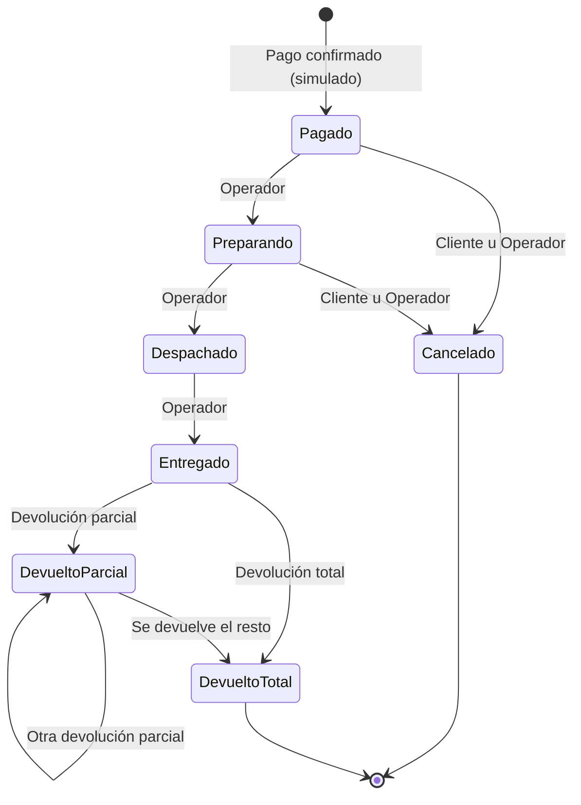

# ShopCart

Plataforma de ventas en línea — **Tech Challenge 360 · Grupo Pentandra** (Full Stack Middle/Senior, individual).
Base de datos SQL Server + API Node.js/TypeScript (Express) + frontend React (Fase 2).

> **Estado:** Fase 1 (base de datos y backend) completa. El frontend (`web/`) corresponde a la Fase 2.

| Documento                          | Contenido                                                               |
| ---------------------------------- | ----------------------------------------------------------------------- |
| **Este README**                    | Instalación, credenciales, decisiones, estados, pruebas                 |
| [docs/ERD.md](docs/ERD.md)         | **Diagrama entidad-relación** (generado desde el esquema real de la BD) |
| [ARQUITECTURA.md](ARQUITECTURA.md) | Diseño detallado: tablas, SPs, flujos, contrato API y plan              |
| `http://localhost:3000/api/docs`   | OpenAPI / Swagger UI (también `/api/openapi.json`)                      |
| [docs/postman/](docs/postman)      | Colección Postman (60 requests) y entorno                               |

---

## 1. Instalación (máquina limpia)

Requisitos: **Node.js ≥ 24**, **Docker con Compose** (para SQL Server). No requiere nada más.

```bash
git clone <repositorio> shopcart && cd shopcart
cp .env.example .env              # cambia las contraseñas si quieres (ver §1.1)
docker compose up -d --wait       # SQL Server 2022 Express; espera al healthcheck
npm install
npm run db:setup                  # crea la BD, todos los objetos y los datos semilla (~15 s)
npm run dev                       # API en http://localhost:3000/api/v1
```

Comprobación: `curl localhost:3000/api/v1/health` → `{"success":true,"data":{"status":"ok","db":"up"}}`

### 1.1 Configuración

Todo por variables de entorno (`.env.example` documenta cada una; **`.env` no se versiona**). Las
dos contraseñas de BD (`MSSQL_SA_PASSWORD`, `DB_APP_PASSWORD`) y `JWT_SECRET` (≥ 32 caracteres) deben
cambiarse fuera de desarrollo. La contraseña de `sa` solo la usa el runner de migraciones; **la API
se conecta con un login propio (`shopcart_app`) que únicamente tiene `EXECUTE`** sobre los SPs.

### 1.2 Comandos

| Comando                | Qué hace                                                                      |
| ---------------------- | ----------------------------------------------------------------------------- |
| `npm run db:setup`     | `DROP DATABASE` + aplica todos los scripts numerados (solo desarrollo)        |
| `npm run db:migrate`   | Aplica solo los scripts pendientes; **falla si un script ya aplicado cambió** |
| `npm test`             | Reconstruye la BD con el seed y corre las pruebas de la API (110 pruebas)     |
| `npm run lint`         | ESLint (incluye reglas de dependencias entre módulos) + Prettier              |
| `npm run typecheck`    | `tsc --noEmit` (TypeScript `strict`) en todos los workspaces                  |
| `npm run docs:erd`     | Regenera `docs/ERD.md` desde la BD                                            |
| `npm run docs:postman` | Regenera la colección Postman desde el documento OpenAPI                      |

> Las pruebas escriben datos sobre la BD. Después de correrlas, `npm run db:setup` deja el conjunto de
> demostración limpio (`npm test` en la raíz ya lo hace antes de probar).

## 2. Credenciales de prueba

Contraseña de **todas** las cuentas: `ShopCart2026!` (solo existe en el seed; el hash es argon2id).

| Rol               | Correo                                                    | Notas                                                    |
| ----------------- | --------------------------------------------------------- | -------------------------------------------------------- |
| **Administrador** | `admin@shopcart.test`                                     | Catálogo, precios, cupones, usuarios, reportes, bitácora |
| **Operador**      | `operador@shopcart.test`, `operador2@shopcart.test`       | Pedidos e inventario                                     |
| **Cliente**       | `cliente@shopcart.test`, `cliente2@shopcart.test`         | Con historial de pedidos                                 |
| Clientes extra    | `maria.lopez@correo.test`, `jose.perez@correo.test`… (30) | Mismo seed                                               |
| Desactivado       | `hector.tzoc@correo.test`                                 | No puede iniciar sesión; conserva su historial           |

**Cupones del seed:** `BIENVENIDA10` (10 %), `VERANO15` (15 %, solo Ropa, mínimo Q300), `ENVIO50` (Q50, mínimo Q400),
`TECH100` (Q100, solo Tecnología, mínimo Q800), `FLASH20` (20 %), `AGOTADO10` (sin usos), `NAVIDAD25` (aún no vigente),
`BLACKFRIDAY30` (vencido).

**Datos de demostración:** 40 productos / 119 variantes (5 sin stock, 7 con stock bajo), 32 clientes con dirección,
8 cupones, **420 pedidos en ~6 meses** en todos los estados (con devoluciones y cupones), 15 carritos abandonados
y 2 productos descontinuados. El seed usa los mismos SPs que la aplicación y luego retrofecha los pedidos;
la bitácora nunca se modifica (ver decisión 23).

## 3. Arquitectura

```
contracts/   esquemas zod + tipos + códigos de error: ÚNICA fuente de verdad API ↔ web
db/          scripts SQL numerados (001…011) + run.mjs (migraciones) + erd.mjs
api/src/
  modules/   auth · catalog · inventory · cart · coupons · orders · reports
             cada módulo = 3 archivos:  routes → service → repository → executeSp → SP
  shared/    config, db (único acceso a la BD), auth, errores, http
  jobs/      liberación de reservas vencidas (cada 60 s)
  openapi.ts documento OpenAPI generado desde contracts
web/         React + Vite + Mantine (Fase 2)
```

- **Capas:** rutas (validación zod + HTTP) → servicios (reglas de negocio) → repositorios (invocan SPs). Sin lógica de
  negocio en rutas. Los módulos **no se importan entre sí** y `shared` no importa módulos; lo hace cumplir ESLint
  (`eslint-plugin-boundaries`), y `npm run lint` falla si alguien lo rompe.
- **Acceso a datos solo por stored procedures:** el backend no contiene SQL ni ORM; `executeSp` es el único punto de
  acceso y pasa parámetros **tipados**. Las vistas (`VW_`) y funciones tipo tabla (`FU_`) las consumen los SPs.
- **Convenciones de BD** del enunciado: `SP_Modulo_Proceso`, `VW_Modulo_Proceso`, `FU_Modulo_Proceso`, llaves `IDEntidad`;
  restricciones con prefijo `PK_/FK_/UQ_/CK_/IX_/DF_`. Sin `FLOAT`/`REAL`: todo monto es `DECIMAL(18,2)`.
- **Errores centralizados:** los SPs lanzan `THROW` con números estables (50001…50099) que `shared/errors.ts` traduce a un
  código de error y HTTP (`400/401/403/404/409/429/500`); el cliente siempre recibe `{ success:false, error:{ code, message } }`.

### 3.1 Seguridad

- Contraseñas con **argon2id**; access JWT de 15 min en memoria; **refresh token opaco de 7 días en cookie `httpOnly`**
  (`SameSite=Lax`, ruta restringida), guardado como SHA-256, con **rotación** y **detección de reuso** (reusar un refresh
  ya rotado revoca toda su familia).
- **Los permisos se verifican en la BD**, no solo en el backend: cada SP recibe `@IDUsuarioSesion`, consulta el rol real
  del usuario (`SP_Auth_ExigirRol`) y valida la propiedad del recurso. Cambiar un id de pedido, carrito o dirección en la
  URL o el body de otro cliente → `403`; token expirado → `401`.
- `helmet`, CORS por lista de orígenes, límite de 10 intentos/min en login/registro/refresh, cuerpo JSON ≤ 100 kB.
- **SQL injection:** los SPs se invocan con parámetros tipados; **no hay SQL dinámico** ni concatenación de valores en
  sentencias SQL (ni en el backend ni dentro de los SPs). Las búsquedas `LIKE` escapan `% _ [` en el parámetro.
- El login de la aplicación solo tiene `EXECUTE`: aunque el backend se comprometiera no podría hacer `SELECT/UPDATE`
  directos sobre las tablas.
- Sin credenciales en el repositorio (solo `.env.example`).

## 4. Ciclo de vida del pedido (RF-07)



- La transición se valida **dos veces**: en el backend (constante `TRANSICIONES` de `contracts`) y en la base de datos
  (tabla `PedidoTransiciones` + `THROW 50030`), de modo que llamar al SP directamente tampoco permite saltarse el flujo.
- **Cancelar** (hasta `Preparando`, es decir, mientras no se despacha) y **devolver** reintegran la existencia con
  movimientos de kardex (`Cancelacion` / `Devolucion`).
- **Devoluciones** totales o parciales **por línea**; no se puede devolver más de lo vendido (`50032`). El reembolso es
  proporcional al total de la línea (incluye su parte del descuento) y la última unidad absorbe el residuo de centavos,
  de modo que Σ reembolsos = total de la línea **al centavo**. El envío no se reembolsa.
- Cada cambio guarda usuario, fecha y hora, estado anterior y nuevo (`PedidoEstadoHistorial`) y una entrada de bitácora.

## 5. Checkout, concurrencia e integridad

1. `POST /checkout` **reserva 15 min** la existencia de cada variante y **congela el precio** que el cliente vio
   (`InventarioReservas.PrecioUnitario`). Reiniciarlo libera las reservas previas (idempotente).
2. `POST /orders` (pago simulado) con cabecera **`Idempotency-Key`** crea el pedido en **una sola transacción**:
   idempotencia → dirección y envío → reservas vigentes → cupón → totales → pedido y líneas (precio y dirección congelados)
   → kardex de venta → uso del cupón → historial → bitácora → cierre del carrito. Todo o nada.
3. **Sin sobreventa:** `UPDLOCK, HOLDLOCK` y `UPDATE` condicional sobre la existencia, con **orden fijo de bloqueo por
   variante** (sin deadlocks entre checkouts); el `executeSp` reintenta además un deadlock (1205) hasta 2 veces.
4. **Idempotencia:** `UNIQUE(IDUsuario, LlaveIdempotencia)` + bloqueo de rango: 5 pagos simultáneos con la misma llave
   producen un único pedido (los demás reciben el mismo pedido con `200`).
5. **Cupones:** la fila del cupón se bloquea antes de contar usos, así el límite total se respeta aunque varios clientes
   paguen a la vez. Un descuento nunca supera el subtotal elegible (total ≥ 0).
6. **Kardex:** un único punto de entrada (`SP_Inventario_AplicarMovimiento`) garantiza
   `CantidadFisica = SUM(kardex)`; disponible = física − reservada.
7. **Reservas vencidas:** un job cada 60 s las libera y, además, se expiran de forma perezosa al reservar esa misma variante
   (nunca bloquean una compra aunque el job no haya corrido). SQL Server Express no tiene SQL Agent, de ahí el job en Node.
8. Los montos los calcula **siempre la base de datos** (`FU_Carrito_CalcularTotales`); la API solo los transporta. El pedido
   incluye un desglose informativo de **IVA 12 % incluido** (`Total − ROUND(Total/1.12, 2)`).

## 6. Decisiones abiertas del enunciado

El enunciado deja abiertas varias decisiones a propósito. Postura adoptada y su razón:

| #   | Tema                                        | Postura                                                                                                         | Por qué                                                                              |
| --- | ------------------------------------------- | --------------------------------------------------------------------------------------------------------------- | ------------------------------------------------------------------------------------ |
| 1   | Ciclo de vida del pedido                    | Diagrama de §4; el pedido nace en `Pagado`, sin `PendientePago`                                                 | El pago simulado es atómico con la creación: ningún pedido "pendiente" es observable |
| 2   | Qué es un pedido «completado» para reportes | Pagado y no cancelado (`PedidoEstados.CuentaComoVenta`); las devoluciones se restan por línea                   | Coincide con el glosario («pedidos pagados»); cambiable por dato, sin tocar SPs      |
| 3   | Pago                                        | Simulado y siempre aprobado, dentro de `SP_Pedidos_CrearPedido`                                                 | El foco evaluado es idempotencia y atomicidad, no la pasarela                        |
| 4   | ¿El invitado puede pagar?                   | No: el checkout exige sesión; su carrito se **fusiona** al iniciar sesión o registrarse (`X-Cart-Token`)        | Propiedad de pedidos y direcciones (RF-01)                                           |
| 5   | Fusión de carritos                          | Suma por variante acotada al disponible; el cupón del invitado solo pasa si el usuario no tenía uno             | Nunca deja un carrito por encima del stock                                           |
| 6   | Periodo de «carrito abandonado»             | 60 min, configurable con `CARRITO_ABANDONADO_MIN`                                                               | Configurable sin desplegar código                                                    |
| 7   | Precio que vio el cliente                   | Congelado al iniciar el checkout (15 min de reserva) y definitivo en `PedidoLineas`                             | Cubre cambios de precio durante y después de la compra (RF-02)                       |
| 8   | Quién cancela y hasta cuándo                | El cliente dueño o un Operador, en `Pagado`/`Preparando`                                                        | Texto literal: «mientras no haya sido despachado»                                    |
| 9   | Quién registra devoluciones                 | Operador/Administrador, desde `Entregado`/`DevueltoParcial`                                                     | RF-07: el Operador gestiona los pedidos; el cliente solo consulta                    |
| 10  | Monto reembolsado                           | Proporcional al total de la línea (incluye descuento); el envío no se reembolsa; cancelar devuelve el total     | Reportes netos exactos al centavo                                                    |
| 11  | Stock devuelto                              | Siempre reingresa (kardex `Devolucion`)                                                                         | RF-07: «cancelar o devolver reintegra la existencia»                                 |
| 12  | Uso del cupón al cancelar/devolver          | No se reintegra                                                                                                 | Evita abuso del límite; simple de explicar                                           |
| 13  | Mínimo y alcance de un cupón por categoría  | El mínimo se mide contra el subtotal completo; el descuento aplica solo al subtotal de la categoría             | Un cupón de categoría no queda inaplicable por el mínimo                             |
| 14  | Envío                                       | Gratis (desde Q200 tras descuento), Estándar Q25, Express Q45                                                   | El checkout debe confirmar el envío                                                  |
| 15  | IVA 12 % incluido                           | Los precios ya lo incluyen; el pedido y el carrito exponen un desglose informativo                              | Contexto del enunciado: «los precios publicados incluyen IVA»                        |
| 16  | Zona horaria                                | UTC en la BD; filtros y agrupaciones en **America/Guatemala (UTC−6)**; semana ISO (lunes)                       | Una venta a las 23:00 locales cae en su día, no en el siguiente                      |
| 17  | Eliminación física                          | Nunca para entidades con historia: todo es baja lógica (`Activo = 0`)                                           | RF-02 y RF-01 («desactivarse sin borrarse»)                                          |
| 18  | Roles                                       | Columna `Rol` con `CHECK` (3 roles fijos)                                                                       | RF-01 no pide CRUD de roles; menos joins                                             |
| 19  | Permisos                                    | Operador: pedidos e inventario. Administrador: además catálogo, precios, cupones, usuarios, reportes y bitácora | Texto literal de RF-01 y RF-09                                                       |
| 20  | Tokens                                      | Access 15 min en memoria; refresh 7 días en cookie `httpOnly`, con rotación y detección de reuso                | RF-01 y mitigación de XSS                                                            |
| 21  | Liberación de reservas                      | Job cada 60 s + liberación perezosa                                                                             | SQL Server Express no tiene SQL Agent                                                |
| 22  | Imágenes                                    | URL externa                                                                                                     | Sin almacenamiento de archivos; suficiente para el reto                              |
| 23  | Bitácora y datos semilla                    | El seed **no** retrofecha la bitácora: sus entradas llevan la fecha real de carga                               | La inmutabilidad vale también para el seed; no se desactivan triggers                |
| 24  | Ventas netas                                | Solo productos (el envío no es venta de producto); la devolución se atribuye a la fecha del pedido original     | Una sola regla, la misma en KPIs, gráficas y listados                                |

**Decisiones técnicas:** `contracts/` como única fuente del contrato (el OpenAPI y la colección Postman se **generan** de
ahí; una prueba falla si una ruta queda sin documentar); migraciones numeradas con checksum (`VersionesEsquema`);
`READ_COMMITTED_SNAPSHOT` para que reportes y listados no bloqueen el checkout; paginación en servidor (20 por defecto,
máximo 100) con ordenamiento por lista blanca; la lógica crítica vive en la BD y se protege allí también.

## 7. Pruebas

`npm test` (raíz) reconstruye la BD con el seed y ejecuta **110 pruebas de integración** contra la API y la BD reales
(sin mocks de base de datos):

| Archivo             | Cubre                                                                                                                                                                                                                                                                                  |
| ------------------- | -------------------------------------------------------------------------------------------------------------------------------------------------------------------------------------------------------------------------------------------------------------------------------------- |
| `auth.test.ts`      | Registro, login, rotación y reuso de refresh, 401/403, propiedad de direcciones, usuarios                                                                                                                                                                                              |
| `catalog.test.ts`   | CRUD, búsqueda y filtros, baja lógica, cambio de precio que no altera pedidos                                                                                                                                                                                                          |
| `inventory.test.ts` | Entradas/ajustes, kardex = existencias, ajuste sin motivo o negativo, bitácora inmutable                                                                                                                                                                                               |
| `checkout.test.ts`  | **Última unidad con 10 compradores** (1 pedido), **idempotencia con 5 pagos paralelos**, **cupón con 3 usos y 10 compradores**, reserva vencida, límites/mínimo/categoría/vigencia del cupón, redondeo, transiciones (backend **y** BD), cancelación, devoluciones parciales y excesos |
| `reports.test.ts`   | Cancelados no suman, devoluciones restan, venta de las 23:00 locales cae en su día, semana ISO, bitácora                                                                                                                                                                               |
| `perf.test.ts`      | 18 consultas principales con el seed completo, **cada una < 1 s** (RNF de rendimiento)                                                                                                                                                                                                 |
| `openapi.test.ts`   | Documento OpenAPI válido y **cada ruta de Express está documentada** (y viceversa)                                                                                                                                                                                                     |
| `shared.test.ts`    | Mapeo de errores SQL → HTTP, argon2id y JWT, `Idempotency-Key`, lista blanca de ordenamiento                                                                                                                                                                                           |

## 8. Cobertura de requerimientos

| RF    | Módulo                 | Dónde                                                                    |
| ----- | ---------------------- | ------------------------------------------------------------------------ |
| RF-01 | Autenticación y acceso | `modules/auth`, `SP_Auth_*`, `SP_Direcciones_*`                          |
| RF-02 | Catálogo               | `modules/catalog`, `SP_Catalogo_*`, `VW_Catalogo_ProductosTienda`        |
| RF-03 | Inventario y kardex    | `modules/inventory`, `SP_Inventario_*`                                   |
| RF-04 | Carrito                | `modules/cart`, `SP_Carrito_*`, `FU_Carrito_CalcularTotales`             |
| RF-05 | Cupones                | `modules/coupons`, `SP_Cupones_*`, `FU_Cupones_CalculoDescuento`         |
| RF-06 | Checkout y pago        | `modules/orders`, `SP_Pedidos_IniciarCheckout`, `SP_Pedidos_CrearPedido` |
| RF-07 | Pedidos y devoluciones | `modules/orders`, `SP_Pedidos_*`, `PedidoTransiciones`                   |
| RF-08 | Dashboard y reportes   | `modules/reports`, `SP_Reportes_*`, `VW_Dashboard_*`                     |
| RF-09 | Bitácora               | `SP_Bitacora_*`, `TR_Bitacora_No*` (triggers `INSTEAD OF`), `GET /audit` |

## 9. Limitaciones conocidas y pendiente

- **Fase 2:** el frontend `web/` (React 18 + TypeScript) aún no está construido; el contrato API ↔ web ya está cerrado y
  documentado en `/api/docs`.
- Probado con **SQL Server 2022 Express** (contenedor oficial). No se probó contra 2019.
- Los pagos son simulados (decisión 3); no hay pasarela ni correo.
