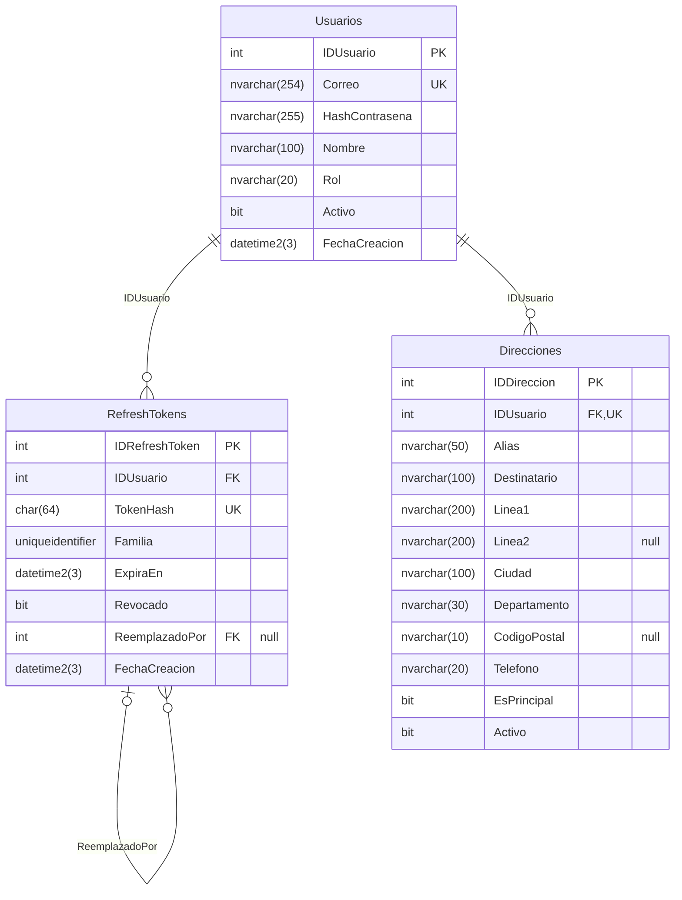
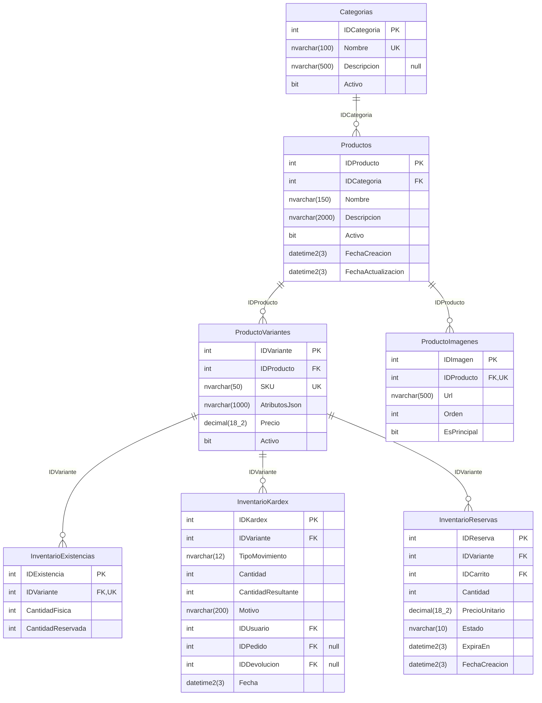
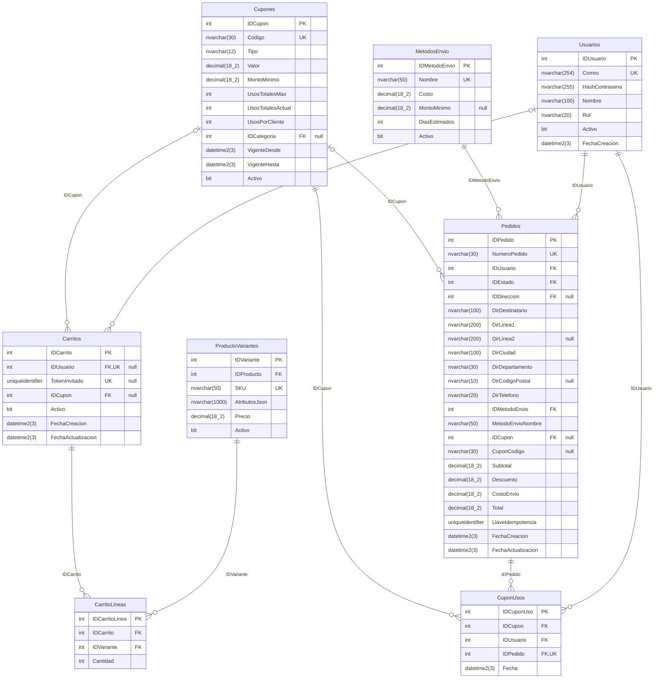
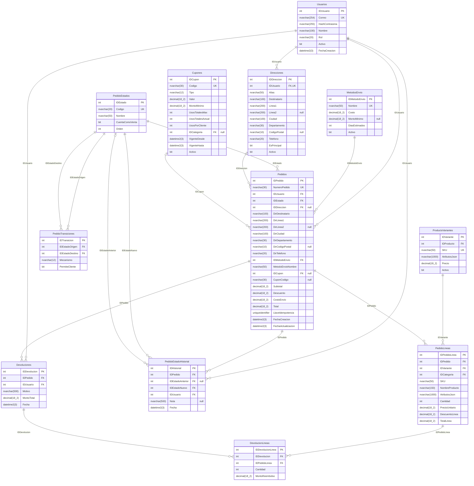
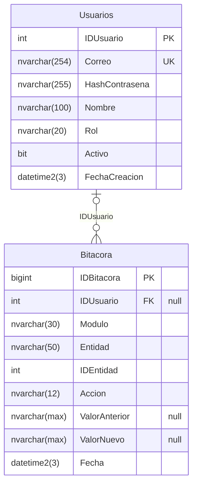

# Diagrama entidad-relación

> Generado desde el catálogo de SQL Server por `db/erd.mjs` (`npm run docs:erd`): refleja el esquema real, no un dibujo manual.
> 23 tablas de dominio (más `VersionesEsquema`, que solo usa el runner de migraciones).
> Notación: `PK` llave primaria · `FK` llave foránea · `UK` única · `"null"` admite NULL. Relaciones: `||--o{` uno a muchos obligatorio, `|o--o{` opcional.

## Vista general

```mermaid
erDiagram
  Bitacora {
    bigint IDBitacora PK
    int IDUsuario FK "null"
    nvarchar(30) Modulo
    nvarchar(50) Entidad
    int IDEntidad
    nvarchar(12) Accion
    nvarchar(max) ValorAnterior "null"
    nvarchar(max) ValorNuevo "null"
    datetime2(3) Fecha
  }
  CarritoLineas {
    int IDCarritoLinea PK
    int IDCarrito FK
    int IDVariante FK
    int Cantidad
  }
  Carritos {
    int IDCarrito PK
    int IDUsuario FK,UK "null"
    uniqueidentifier TokenInvitado UK "null"
    int IDCupon FK "null"
    bit Activo
    datetime2(3) FechaCreacion
    datetime2(3) FechaActualizacion
  }
  Categorias {
    int IDCategoria PK
    nvarchar(100) Nombre UK
    nvarchar(500) Descripcion "null"
    bit Activo
  }
  Cupones {
    int IDCupon PK
    nvarchar(30) Codigo UK
    nvarchar(12) Tipo
    decimal(18_2) Valor
    decimal(18_2) MontoMinimo
    int UsosTotalesMax
    int UsosTotalesActual
    int UsosPorCliente
    int IDCategoria FK "null"
    datetime2(3) VigenteDesde
    datetime2(3) VigenteHasta
    bit Activo
  }
  CuponUsos {
    int IDCuponUso PK
    int IDCupon FK
    int IDUsuario FK
    int IDPedido FK,UK
    datetime2(3) Fecha
  }
  Devoluciones {
    int IDDevolucion PK
    int IDPedido FK
    int IDUsuario FK
    nvarchar(500) Motivo
    decimal(18_2) MontoTotal
    datetime2(3) Fecha
  }
  DevolucionLineas {
    int IDDevolucionLinea PK
    int IDDevolucion FK
    int IDPedidoLinea FK
    int Cantidad
    decimal(18_2) MontoReembolso
  }
  Direcciones {
    int IDDireccion PK
    int IDUsuario FK,UK
    nvarchar(50) Alias
    nvarchar(100) Destinatario
    nvarchar(200) Linea1
    nvarchar(200) Linea2 "null"
    nvarchar(100) Ciudad
    nvarchar(30) Departamento
    nvarchar(10) CodigoPostal "null"
    nvarchar(20) Telefono
    bit EsPrincipal
    bit Activo
  }
  InventarioExistencias {
    int IDExistencia PK
    int IDVariante FK,UK
    int CantidadFisica
    int CantidadReservada
  }
  InventarioKardex {
    int IDKardex PK
    int IDVariante FK
    nvarchar(12) TipoMovimiento
    int Cantidad
    int CantidadResultante
    nvarchar(200) Motivo
    int IDUsuario FK
    int IDPedido FK "null"
    int IDDevolucion FK "null"
    datetime2(3) Fecha
  }
  InventarioReservas {
    int IDReserva PK
    int IDVariante FK
    int IDCarrito FK
    int Cantidad
    decimal(18_2) PrecioUnitario
    nvarchar(10) Estado
    datetime2(3) ExpiraEn
    datetime2(3) FechaCreacion
  }
  MetodosEnvio {
    int IDMetodoEnvio PK
    nvarchar(50) Nombre UK
    decimal(18_2) Costo
    decimal(18_2) MontoMinimo "null"
    int DiasEstimados
    bit Activo
  }
  PedidoEstadoHistorial {
    int IDHistorial PK
    int IDPedido FK
    int IDEstadoAnterior FK "null"
    int IDEstadoNuevo FK
    int IDUsuario FK
    nvarchar(500) Nota "null"
    datetime2(3) Fecha
  }
  PedidoEstados {
    int IDEstado PK
    nvarchar(20) Codigo UK
    nvarchar(50) Nombre
    bit CuentaComoVenta
    int Orden
  }
  PedidoLineas {
    int IDPedidoLinea PK
    int IDPedido FK
    int IDVariante FK
    int IDCategoria FK
    nvarchar(50) SKU
    nvarchar(150) NombreProducto
    nvarchar(1000) AtributosJson
    int Cantidad
    decimal(18_2) PrecioUnitario
    decimal(18_2) DescuentoLinea
    decimal(18_2) TotalLinea
  }
  Pedidos {
    int IDPedido PK
    nvarchar(30) NumeroPedido UK
    int IDUsuario FK
    int IDEstado FK
    int IDDireccion FK "null"
    nvarchar(100) DirDestinatario
    nvarchar(200) DirLinea1
    nvarchar(200) DirLinea2 "null"
    nvarchar(100) DirCiudad
    nvarchar(30) DirDepartamento
    nvarchar(10) DirCodigoPostal "null"
    nvarchar(20) DirTelefono
    int IDMetodoEnvio FK
    nvarchar(50) MetodoEnvioNombre
    int IDCupon FK "null"
    nvarchar(30) CuponCodigo "null"
    decimal(18_2) Subtotal
    decimal(18_2) Descuento
    decimal(18_2) CostoEnvio
    decimal(18_2) Total
    uniqueidentifier LlaveIdempotencia
    datetime2(3) FechaCreacion
    datetime2(3) FechaActualizacion
  }
  PedidoTransiciones {
    int IDTransicion PK
    int IDEstadoOrigen FK
    int IDEstadoDestino FK
    nvarchar(12) Mecanismo
    bit PermiteCliente
  }
  ProductoImagenes {
    int IDImagen PK
    int IDProducto FK,UK
    nvarchar(500) Url
    int Orden
    bit EsPrincipal
  }
  Productos {
    int IDProducto PK
    int IDCategoria FK
    nvarchar(150) Nombre
    nvarchar(2000) Descripcion
    bit Activo
    datetime2(3) FechaCreacion
    datetime2(3) FechaActualizacion
  }
  ProductoVariantes {
    int IDVariante PK
    int IDProducto FK
    nvarchar(50) SKU UK
    nvarchar(1000) AtributosJson
    decimal(18_2) Precio
    bit Activo
  }
  RefreshTokens {
    int IDRefreshToken PK
    int IDUsuario FK
    char(64) TokenHash UK
    uniqueidentifier Familia
    datetime2(3) ExpiraEn
    bit Revocado
    int ReemplazadoPor FK "null"
    datetime2(3) FechaCreacion
  }
  Usuarios {
    int IDUsuario PK
    nvarchar(254) Correo UK
    nvarchar(255) HashContrasena
    nvarchar(100) Nombre
    nvarchar(20) Rol
    bit Activo
    datetime2(3) FechaCreacion
  }
  Usuarios |o--o{ Bitacora : "IDUsuario"
  Carritos ||--o{ CarritoLineas : "IDCarrito"
  ProductoVariantes ||--o{ CarritoLineas : "IDVariante"
  Cupones |o--o{ Carritos : "IDCupon"
  Usuarios |o--o{ Carritos : "IDUsuario"
  Categorias |o--o{ Cupones : "IDCategoria"
  Cupones ||--o{ CuponUsos : "IDCupon"
  Pedidos ||--o{ CuponUsos : "IDPedido"
  Usuarios ||--o{ CuponUsos : "IDUsuario"
  Pedidos ||--o{ Devoluciones : "IDPedido"
  Usuarios ||--o{ Devoluciones : "IDUsuario"
  Devoluciones ||--o{ DevolucionLineas : "IDDevolucion"
  PedidoLineas ||--o{ DevolucionLineas : "IDPedidoLinea"
  Usuarios ||--o{ Direcciones : "IDUsuario"
  ProductoVariantes ||--o{ InventarioExistencias : "IDVariante"
  Devoluciones |o--o{ InventarioKardex : "IDDevolucion"
  Pedidos |o--o{ InventarioKardex : "IDPedido"
  Usuarios ||--o{ InventarioKardex : "IDUsuario"
  ProductoVariantes ||--o{ InventarioKardex : "IDVariante"
  Carritos ||--o{ InventarioReservas : "IDCarrito"
  ProductoVariantes ||--o{ InventarioReservas : "IDVariante"
  PedidoEstados |o--o{ PedidoEstadoHistorial : "IDEstadoAnterior"
  PedidoEstados ||--o{ PedidoEstadoHistorial : "IDEstadoNuevo"
  Pedidos ||--o{ PedidoEstadoHistorial : "IDPedido"
  Usuarios ||--o{ PedidoEstadoHistorial : "IDUsuario"
  Categorias ||--o{ PedidoLineas : "IDCategoria"
  Pedidos ||--o{ PedidoLineas : "IDPedido"
  ProductoVariantes ||--o{ PedidoLineas : "IDVariante"
  Cupones |o--o{ Pedidos : "IDCupon"
  Direcciones |o--o{ Pedidos : "IDDireccion"
  PedidoEstados ||--o{ Pedidos : "IDEstado"
  MetodosEnvio ||--o{ Pedidos : "IDMetodoEnvio"
  Usuarios ||--o{ Pedidos : "IDUsuario"
  PedidoEstados ||--o{ PedidoTransiciones : "IDEstadoDestino"
  PedidoEstados ||--o{ PedidoTransiciones : "IDEstadoOrigen"
  Productos ||--o{ ProductoImagenes : "IDProducto"
  Categorias ||--o{ Productos : "IDCategoria"
  Productos ||--o{ ProductoVariantes : "IDProducto"
  RefreshTokens |o--o{ RefreshTokens : "ReemplazadoPor"
  Usuarios ||--o{ RefreshTokens : "IDUsuario"
```

## Seguridad y direcciones

Usuarios, sesiones (refresh tokens) y direcciones de entrega.

## Catálogo e inventario

Productos con variantes, existencias, reservas temporales y kardex.

## Carrito, cupones y envío

Carrito de cliente o invitado, cupones con sus usos y métodos de envío.

## Pedidos y devoluciones

Pedido con precios congelados, ciclo de vida (estados y transiciones) y devoluciones por línea.

## Auditoría

Bitácora inmutable (triggers INSTEAD OF) y control de migraciones.

